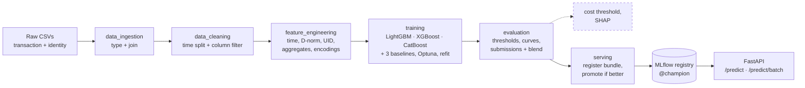

# 1. Introduction

This folder documents the **fraud-detection-kedro** project: an end-to-end MLOps project that
scores online card transactions for fraud on the
[IEEE-CIS Fraud Detection](https://www.kaggle.com/competitions/ieee-fraud-detection) dataset.
It covers the whole path from raw Kaggle CSVs to a model served behind a REST API:

```
Kaggle CSVs ──► Kedro pipelines ──► MLflow (tracking + registry) ──► FastAPI /predict
```

## Table of contents

| # | Document | What's inside |
|---|---|---|
| 1 | **Introduction** (this page) | The problem, the approach, project status, how to read these docs |
| 2 | [Infrastructure](02_infrastructure.md) | Tech stack, repo layout, configuration, MLflow, Docker, CI, Makefile |
| 3 | [Data description](03_data_description.md) | The raw Kaggle files, the meaning of every column group, categorical vs numerical, known pitfalls |
| 4 | [Data layers and catalog](04_data_layers.md) | What each `data/0X_*` folder holds and which catalog dataset writes it |
| 5 | [Pipelines](05_pipelines.md) | The pipeline diagram, plus every pipeline node by node with its inputs, outputs and parameters |
| 6 | [Modeling approach](06_modeling_approach.md) | How the project handles class imbalance, drift over time, and ~430 columns with many nulls; what every model hyperparameter means |
| 7 | [Serving API](07_serving_api.md) | The FastAPI service, request/response format, how a model reaches the API |
| 8 | [Model card](08_model_card.md) | Intended use, training data, evaluation, current results, limitations |

**Suggested reading order**

- *New to the project:* 1 → 2 → 5. That's enough to run everything and know where things are.
- *Working on features or the model:* 3 → 6 → 5.
- *Deploying or calling the model:* 2 → 7 → 8.

## The problem

Vesta, a payment provider, wants the **probability that an online (card-not-present)
transaction is fraudulent** (the binary target `isFraud`). Four properties of the data shape
every design decision in this project:

| Property | In numbers | Consequence |
|---|---|---|
| **Rare positive class** | 3.5% of transactions are fraud | Accuracy is meaningless. Use PR-AUC and ROC-AUC, and pick the threshold by business cost |
| **Change over time** | ~6 months of data; the test set comes *after* train | Validate on later days than you train on, never with a random split. Remove or transform features that drift |
| **Wide and sparse** | ~435 columns after the join; many columns are 45–99% null; 339 anonymised `V` columns | Screen features automatically instead of inspecting each one; use models that handle NaN natively |
| **Real time** | A decision is needed within milliseconds | One model artifact; the API must compute features exactly as training did (no training/serving skew) |

## The approach in one picture



*The dashed box is planned and not implemented yet.*

The key ideas:

1. **Time-based validation**: train on the first 80% of days (days 1–140) and validate on the
   rest (days 141–182).
2. **Fit on train, apply everywhere**: every learned transformation (the column filter, group
   statistics, frequency and category encodings) is fitted on the train split only, saved as an
   artifact, and applied unchanged to valid, test and single API requests. This prevents leakage
   and keeps scoring identical to training.
3. **Automatic feature screening**: drop near-empty and near-constant columns, then collapse
   highly correlated `V` columns within blocks that share the same null pattern
   (435 → 355 columns), and let gradient-boosted trees handle the remaining NaNs.
4. **Three gradient-boosting models plus three baselines compared side by side** in MLflow
   (logistic regression, random forest, scikit-learn HistGradientBoosting). Optuna tuning on the
   time-based validation split is available, and a refit on train + valid produces the Kaggle
   submissions.

## Project status

| Area | Status |
|---|---|
| Repo structure, setup scripts, Kaggle download with checksum manifest | Done |
| `data_ingestion`: schema typing, train/test column fix, transaction ⟕ identity join | Done |
| `data_cleaning`: time split, column filter fitted on train | Done |
| `feature_engineering`: stateless features, encoders fitted on train, model input | Done |
| `training`: LightGBM, XGBoost, CatBoost with Optuna + logreg / random forest / HistGB baselines; imbalance switch, optional time-series CV, refit on train + valid for submissions | Done (trained with base params; tuning not run yet) |
| FastAPI service: `/predict`, `/predict/batch`, liveness/readiness, Prometheus `/metrics`, request IDs, prediction log; Dockerfile (multi-worker), docker compose | Done |
| Inference wrapper `InferenceBundle` (raw rows → probability with the pipeline's own node functions) + `FraudPyfunc` (MLflow pyfunc) | Done |
| CI: lint, tests, Kedro load check, Docker build | Done |
| `data_validation` (pandera schemas, train/test parity) | Planned (pipeline is empty) |
| `evaluation`: precision / recall / F1 at 3 thresholds, PR + ROC curves (logged into MLflow), Kaggle submission per model + blend | Done |
| Scripts: run history from MLflow, feature-count study, API load test | Done |
| `evaluation`: cost-based threshold, SHAP | Planned |
| `serving`: register the inference bundle in the MLflow registry, move `@champion` only if valid PR-AUC improves (`make register`) | Done |

**Latest results**: all models use their base `params` (no Optuna tuning yet). Validation is
on days 141–182, with 395 features:

| Model | Valid ROC-AUC | Valid PR-AUC | Recall @ 1% FPR | Best F1 | Train ROC-AUC | Fit time |
|---|---|---|---|---|---|---|
| LightGBM | **0.9315** | **0.6137** | **0.537** | **0.596** | 0.9991 | 92 s |
| XGBoost (GPU) | 0.9292 | 0.6117 | 0.531 | 0.589 | 0.9962 | 59 s |
| HistGB (baseline) | 0.9197 | 0.5910 | 0.524 | 0.583 | 0.9917 | 164 s |
| CatBoost (GPU) | 0.9056 | 0.5449 | 0.467 | 0.548 | 0.9708 | 291 s |
| Random forest (baseline) | 0.8884 | 0.4482 | 0.387 | 0.465 | 0.9520 | 93 s |
| Logistic regression (baseline) | 0.8361 | 0.1958 | 0.017 | 0.340 | 0.8895 | 178 s |

*Recall @ 1% FPR*: the share of fraud caught when 1 in 100 legitimate transactions is flagged.
At that threshold, LightGBM catches 54% of fraud.

Sources: `data/08_reporting/{model}_metrics.json` and `{model}_evaluation.json`. Every tree model
shows a train–valid ROC-AUC gap of 0.06–0.07, which points to overfitting and/or drift. A plain
scikit-learn HistGB already comes within 0.02 PR-AUC of LightGBM. See
[Modeling approach](06_modeling_approach.md#known-limitations).

## Glossary

| Term | Meaning |
|---|---|
| **Split** | `train` (earlier days of the Kaggle train file), `valid` (later days), `test` (the Kaggle test file, unlabelled) |
| **Fitted artifact** | A file learned from train and reused everywhere: `column_filter.json`, `feature_encoders.pkl`, `{model}.pkl` |
| **Final model** | `{model}_final.pkl`: refitted on train + valid for the test submission. It has no validation score of its own |
| **Inference bundle** | `InferenceBundle`: the fitted artifacts + model + parameters, scoring raw rows exactly as the pipelines do |
| **UID** | Pseudo client ID `card1 + addr1 + D1_norm`. It approximates "the same card holder" |
| **D-norm** | `day − D_n`. Turns "days since X" (which grows over time) into "the day X happened" (stable) |
| **Champion** | The MLflow registry alias of the model version the API serves |
| **PR-AUC** | Area under the precision–recall curve (average precision). The main metric for a rare positive class |

---
[Next: 2. Infrastructure →](02_infrastructure.md)
