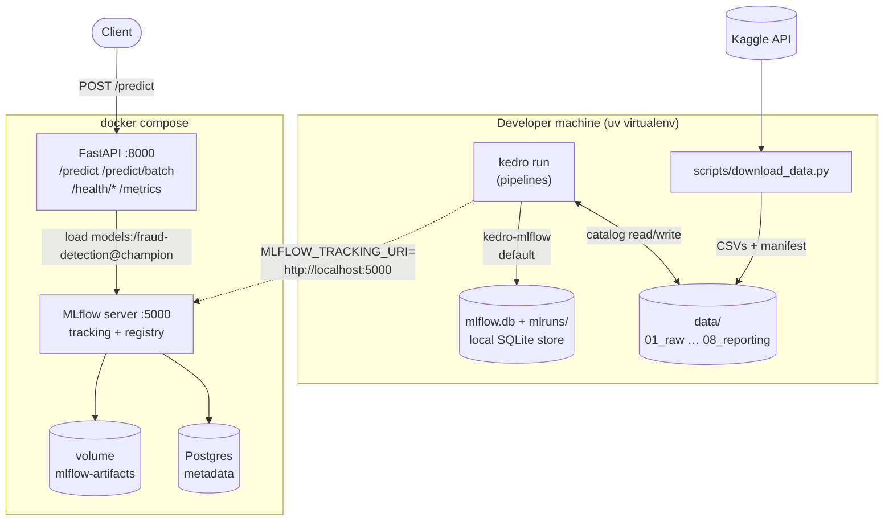
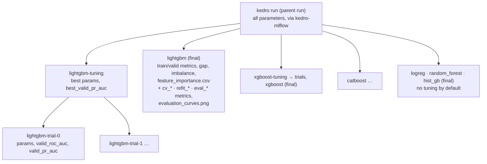
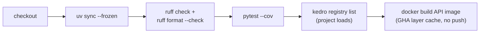

# 2. Infrastructure

[← 1. Introduction](01_introduction.md) · [Table of contents](01_introduction.md#table-of-contents)

This page covers what the project runs on and how the parts connect: tools, repository layout,
configuration, experiment tracking, containers and CI.

## Tech stack

| Layer | Tool | Role in this project |
|---|---|---|
| Environment | [uv](https://docs.astral.sh/uv/), Python 3.12 (`.python-version`; 3.11–3.13 supported) | Virtualenv, locked dependencies (`uv.lock`) |
| Pipelines | [Kedro](https://kedro.org) 1.x, `kedro-datasets` | Nodes, pipelines, data catalog, parameters |
| Pipeline graph | `kedro-viz` (dev) | Interactive lineage graph (`make viz`) |
| Data | pandas, pyarrow (parquet) | In-memory tables, columnar storage between layers |
| Models | LightGBM, XGBoost, CatBoost; scikit-learn (logistic regression, random forest, HistGradientBoosting, metrics) | Gradient-boosted trees, baselines, ROC-AUC / PR-AUC |
| Reporting | matplotlib | PR and ROC curves per model (`{model}_curves.png`) |
| Tuning | Optuna (TPE sampler) | Hyperparameter search on the time-based validation split |
| Tracking | MLflow ≥ 2.17 via `kedro-mlflow` | Parameters, metrics, artifacts, model registry |
| Validation (planned) | pandera | Schema and value-range checks |
| Explainability (planned) | SHAP | Global and per-prediction explanations |
| Serving | FastAPI, uvicorn, pydantic | REST scoring service |
| Monitoring | `prometheus-fastapi-instrumentator`, `prometheus_client` | `/metrics`: request latency, prediction counts and probability histogram |
| Containers | Docker, docker compose, Postgres 16 | Serving stack with an MLflow server |
| Quality | ruff, pytest, pytest-cov, pre-commit | Lint, format, tests |
| CI | GitHub Actions | Lint → tests → Kedro load check → Docker build |

## System overview



By default, `kedro run` logs to a **local SQLite store** (`mlflow.db`, artifacts in `./mlruns`).
Set `MLFLOW_TRACKING_URI=http://localhost:5000` to log to the compose server instead. The API
needs that second option, because it only sees the compose server.

## Repository layout

```
fraud-detection-kedro/
├── conf/
│   ├── base/                          # committed configuration
│   │   ├── catalog.yml                # every dataset, mostly dataset factories
│   │   ├── parameters.yml             # shared: random_state, target
│   │   ├── parameters_data_ingestion.yml
│   │   ├── parameters_data_cleaning.yml
│   │   ├── parameters_feature_engineering.yml
│   │   ├── parameters_training.yml    # one block per model
│   │   ├── parameters_evaluation.yml  # fixed threshold, target FPR
│   │   └── mlflow.yml                 # kedro-mlflow config
│   ├── local/                         # machine overrides + secrets (git-ignored)
│   └── logging.yml                    # console (rich) + logs/info.log, logs/errors.log
├── data/                              # git-ignored, see 04_data_layers.md
├── docker/mlflow.Dockerfile           # MLflow server image (+ psycopg2)
├── docs/                              # this documentation
├── notebooks/                         # exploration only, no pipeline logic
├── scripts/
│   ├── download_data.py               # Kaggle download, idempotent, SHA256 manifest
│   ├── compare_runs.py                # history of final model runs from MLflow (make compare)
│   ├── feature_size_study.py          # accuracy / size / latency vs top-N features (make feature-study)
│   ├── loadtest.py                    # open-loop async load test of a running API (make loadtest)
│   ├── setup.ps1 / setup.sh           # one-command setup
├── src/fraud_detection/
│   ├── pipelines/
│   │   ├── data_ingestion/            # nodes.py + pipeline.py per pipeline
│   │   ├── data_validation/           # (planned, empty)
│   │   ├── data_cleaning/
│   │   ├── feature_engineering/
│   │   ├── training/                  # + model.py: FraudModel wrapper
│   │   └── evaluation/                # precision / recall, curves, Kaggle submissions
│   ├── api/                           # main.py (FastAPI), schemas.py (pydantic)
│   ├── inference.py                   # InferenceBundle (raw rows → probability) + FraudPyfunc (MLflow)
│   ├── keys.py                        # to_key(): stable string keys for categories
│   ├── pipeline_registry.py           # which pipelines exist
│   └── settings.py                    # OmegaConfigLoader + oc.env resolver
├── tests/                             # mirrors src/: api/, pipelines/
├── .github/workflows/ci.yml
├── Dockerfile                         # API image (multi-stage, uv)
├── docker-compose.yml                 # Postgres + MLflow + API
├── Makefile
└── pyproject.toml                     # deps, ruff, pytest, Kedro metadata
```

## Configuration

Kedro loads configuration with `OmegaConfigLoader` (`src/fraud_detection/settings.py`):

| Item | Value |
|---|---|
| Base environment | `conf/base/` (committed) |
| Default run environment | `conf/local/` (overrides base, git-ignored, holds `credentials.yml` if needed) |
| Other environments | `kedro run --env <name>` reads `conf/<name>/` on top of base |
| Custom resolver | `${oc.env:VAR,default}`, used in `mlflow.yml` so Docker or CI can redirect tracking |

**Parameters** are split per pipeline. Each `parameters_<pipeline>.yml` holds one top-level key
(`data_ingestion`, `data_cleaning`, `feature_engineering`) and each node receives the whole block
(`params:data_cleaning`). Training has one block per model (`lightgbm`, `xgboost`, `catboost`,
`logreg`, `random_forest`, `hist_gb`), and each block is that model's `model_options` inside its namespaced pipeline. Shared values
(`target: isFraud`, `random_state: 42`) live in `parameters.yml`.

You can override any parameter from the CLI without editing files:

```bash
uv run kedro run --pipelines training_xgboost --params "xgboost.model_options.n_trials=50"
```

**Catalog**: `conf/base/catalog.yml` uses *dataset factories*, so one entry covers all splits:

```yaml
"prm_{split}":                       # matches prm_train, prm_valid, prm_test
  type: pandas.ParquetDataset
  filepath: data/03_primary/{split}.parquet
```

Datasets that aren't in the catalog (for example `train_split` or `train_stateless`) are kept in
memory for the duration of the run. The full mapping is in [04_data_layers.md](04_data_layers.md).

**Environment variables** (`.env.example` → `.env`; docker compose loads it, local runs need it
exported):

| Variable | Default | Used by |
|---|---|---|
| `MLFLOW_TRACKING_URI` | `sqlite:///mlflow.db` (in `mlflow.yml`) | `kedro-mlflow`, API |
| `MODEL_URI` | `models:/fraud-detection@champion` | API |
| `FRAUD_THRESHOLD` | empty → the `threshold` stored in the model metadata → `0.5` | API, decision cut-off |
| `WEB_CONCURRENCY` | `2` | API container: number of uvicorn worker processes |
| `LOG_LEVEL` | `INFO` | API logging (request lines + one JSON line per prediction) |
| `OMP_NUM_THREADS` | `1` (set in the image) | One OpenMP thread per worker, so workers don't oversubscribe the CPUs |
| `PROMETHEUS_MULTIPROC_DIR` | `/tmp/prometheus` (set in the image) | Lets `/metrics` aggregate across workers |
| `KAGGLE_API_TOKEN` | — | `download_data.py` (alternative to `~/.kaggle/access_token`) |
| `KEDRO_LOGGING_CONFIG` | `conf/logging.yml` | Kedro logging |

## Experiment tracking (MLflow)

`kedro-mlflow` registers its hooks through entry points, so it needs no code in `settings.py`.
The experiment is called `fraud-detection` (in `conf/base/mlflow.yml`). Long parameters are
truncated.

Each `kedro run` opens one parent run. The training pipeline adds nested runs below it:



The **final** run is the model's single row in MLflow. Later nodes write into it by run ID
(`FraudModel.mlflow_run_id`), even when they run in a separate `kedro run`:

| Written by | Metrics added to the final run |
|---|---|
| `train_model` | `train_*`, `valid_*`, `roc_auc_gap`, `best_iteration`, `n_features`, `fit_seconds`; params incl. `device`, `imbalance` |
| `cross_validate` (if `cv_folds > 0`) | `cv_roc_auc_mean/std`, `cv_pr_auc_mean/std` |
| `refit_model` (if `refit: true`) | `refit_rows`, `refit_iterations`, `refit_seconds` |
| `evaluate_model` | `eval_*` (precision / recall / F1 / FPR / confusion counts at three thresholds) + the `evaluation_curves.png` figure |

Every model logs the same metric names, so you can compare them side by side in the MLflow UI.
Tags `model_type` and `stage` (`tuning` / `trial` / `final`) make filtering easy.

```bash
uv run mlflow ui --backend-store-uri sqlite:///mlflow.db --port 5000   # make mlflow
```

Run it **from the project folder**: `sqlite:///mlflow.db` is a relative path, so starting the UI
anywhere else silently creates a new, empty database there. Keep the terminal open, then open
http://localhost:5000.

**Seeing the runs in the UI (MLflow 3):**

Fastest: open
http://localhost:5000/#/experiments/1/runs?searchFilter=tags.stage%20%3D%20%27final%27&orderByKey=metrics.%60valid_pr_auc%60&orderByAsc=false
(the final model runs, best PR-AUC first; append `&compareRunsMode=CHART` for bar charts).
By hand:

1. Click the **fraud-detection** experiment (not *Default*, which is empty). Switch the toggle at
   the top left from **GenAI** to **Model training**.
2. Open the **Runs** tab. The experiment carries the tag
   `mlflow.experimentKind = custom_model_development` (set in `mlflow.yml`), which makes MLflow 3
   show the classic runs table instead of the GenAI traces view. If an older experiment lacks it,
   add it once: experiment page → **⋮** → edit tags, or with `MlflowClient().set_experiment_tag(...)`.
3. Child runs are collapsed under their parent: click **+** next to a `training` run to expand
   the per-model runs (**lightgbm / xgboost / catboost / logreg / random_forest / hist_gb**). Or filter with `tags.stage = 'final'` in the search bar.
4. **Columns** → add `valid_roc_auc`, `valid_pr_auc`, `roc_auc_gap`, `eval_at_fpr_recall`; click a header to sort.
5. Select runs → **Compare** for parameter / metric charts.

`ERR_CONNECTION_REFUSED` on localhost:5000 means the UI process is not running.

**History of all trained models as a table** (every final model run, newest first):

```bash
uv run python scripts/compare_runs.py            # all runs (make compare)
uv run python scripts/compare_runs.py --last 1   # only the latest kedro run
```

It prints the table and saves it to `data/08_reporting/model_comparison.csv` and `.md`. The
columns cover training, CV, refit and `eval_*` metrics; any column a run didn't produce stays empty.

## Containers

### Images

| Image | File | Contents |
|---|---|---|
| API | `Dockerfile` | Multi-stage. The **builder** stage runs `uv sync --frozen --no-dev` (dependencies are cached in their own layer before the source is copied). The **runtime** stage is `python:3.12-slim` + `libgomp1` (needed by LightGBM) + the virtualenv. It runs as the non-root `app` user, and its `HEALTHCHECK` hits `/health/live` (liveness only: the container counts as healthy even without a model). It starts `uvicorn` on port 8000 with `WEB_CONCURRENCY` workers (default 2) and `--no-access-log` (the app's middleware logs requests). It also sets `OMP_NUM_THREADS=1` and resets `PROMETHEUS_MULTIPROC_DIR` at start |
| MLflow | `docker/mlflow.Dockerfile` | `python:3.12-slim` + `mlflow>=3.5,<4` + `psycopg2-binary` |

### docker compose services

| Service | Image | Port | Storage | Depends on |
|---|---|---|---|---|
| `postgres` | `postgres:16-alpine` | internal | volume `postgres-data` | — (healthcheck `pg_isready`) |
| `mlflow` | `docker/mlflow.Dockerfile` | 5000 | volume `mlflow-artifacts` (`/mlartifacts`) | `postgres` healthy |
| `api` | `Dockerfile` | 8000 | — | `mlflow` |

The MLflow server stores run metadata in Postgres and serves artifacts itself
(`--artifacts-destination`), so clients don't need direct access to the storage.
`--allowed-hosts` lets the server be reached both as `mlflow:5000` (from the API container) and
as `localhost:5000` (from the host).

```bash
docker compose up -d --build   # make docker-up
docker compose down            # make docker-down
```

## CI/CD

`.github/workflows/ci.yml` runs on every push to `main` and on every pull request:



Locally, pre-commit runs the same ruff checks plus trailing-whitespace, end-of-file, YAML and
large-file (>1 MB) checks on every commit.

Planned: a scheduled retraining workflow (download data with `KAGGLE_API_TOKEN` → train → evaluate
against a remote MLflow → move `@champion` only if the challenger wins on the cost metric).

## Makefile targets

| Target | Command | What it does |
|---|---|---|
| `make setup` | `scripts/setup.sh` | Install uv + deps, git hooks, `.env`, check Kaggle access |
| `make data` | `download_data.py` | Download the Kaggle CSVs into `data/01_raw` |
| `make ingest` | `kedro run --pipelines data_ingestion` | 01 → 02 |
| `make features` | `… data_cleaning,feature_engineering` | 02 → 05 |
| `make train` | `… training,evaluation` | Tune and train all models, evaluate, write submissions |
| `make train-fast` | `… training,evaluation --params "*.n_trials=0"` | Same, once with the base params, no tuning |
| `make baselines` | `… --namespaces logreg,random_forest,hist_gb` | Train and evaluate only the three baselines |
| `make evaluate` | `kedro run --pipelines evaluation` | Metrics, curves and submissions for the saved models |
| `make compare` | `scripts/compare_runs.py` | Run history table from MLflow |
| `make feature-study` | `scripts/feature_size_study.py` | Accuracy, model size and latency vs number of features |
| `make run` | `kedro run` | All pipelines (`__default__`) |
| `make viz` | `kedro viz run` | Pipeline graph in the browser |
| `make mlflow` | `mlflow ui …` | Local MLflow UI on :5000 |
| `make api` | `uvicorn … --reload` | API with auto-reload |
| `make loadtest` | `scripts/loadtest.py --url $(URL) --requests $(REQUESTS) --batch-sizes $(BATCHES) --duration $(DURATION)` | Open-loop load test of a running API: each of {1, 10, 1000, 10000} requests per minute x {1, 10, 100, 1000} transactions per request; report in `data/08_reporting/loadtest.{csv,md}` |
| `make test` / `lint` / `format` | pytest / ruff | Quality checks |
| `make docker-up` / `docker-down` | docker compose | Start or stop the serving stack |
| `make clean` | `find data … -delete` | Remove generated data (keeps `01_raw`) |

On Windows without `make`, run the `uv run …` command from the table directly.

## Hardware and resources

| Resource | Need |
|---|---|
| Disk | ~4 GB (1.3 GB raw CSVs + parquet layers + models) |
| RAM | ~16 GB is comfortable. Numerical columns are stored as `float32` (`numerical_dtype`), with exceptions only for `TransactionDT` (int64) and `TransactionAmt` (float64) |
| GPU | Optional. XGBoost (`device: cuda`) and CatBoost (`device: GPU`) use an NVIDIA card. The pip build of LightGBM is CPU-only. With no GPU, set `xgboost.model_options.device=cpu` and `catboost.model_options.device=CPU` |
| Serving | CPU only. `FraudModel.predict_proba` switches XGBoost to CPU before scoring. The latency budget in `loadtest.py` is p99 < 50 ms per single-transaction request |
| Model files | Boosting ~14–15 MB per pickle; random forest 69 MB (85 MB refitted); logistic regression < 0.1 MB |

## Setup in short

```powershell
.\scripts\setup.ps1 -Download        # Windows
./scripts/setup.sh --download        # Linux / macOS
uv run kedro run                     # all pipelines
```

Kaggle access (accepting the rules and creating a token) is described in the root
[README](../README.md#setup).

---
[← 1. Introduction](01_introduction.md) · [Next: 3. Data description →](03_data_description.md)
