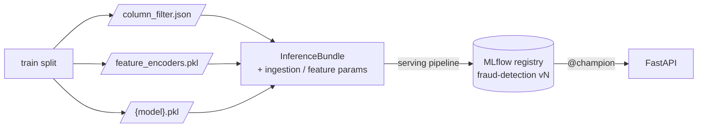

# 4. Data Layers and Catalog

[← 3. Data description](03_data_description.md) · [Table of contents](01_introduction.md#table-of-contents)

`data/` follows Kedro's layered convention. Data flows down through the numbered folders and gets
cleaner and closer to model-ready at each step. Nothing under `data/` is committed: `.gitignore`
excludes everything except the `.gitkeep` files that keep the folder structure.

## Folders

| Folder | Purpose | Contents | Written by |
|---|---|---|---|
| `01_raw` | Original files exactly as downloaded. Never edited. | The 5 Kaggle CSVs and `_manifest.json` | `scripts/download_data.py` |
| `02_intermediate` | Raw data with fixed types and file formats, plus simple joins. No business logic yet. | `train.parquet`, `test.parquet`: transaction + identity joined on `TransactionID` | `data_ingestion` |
| `03_primary` | Clean data: one trusted table per split | `train.parquet` (days 1–140 of int_train), `valid.parquet` (days 141–182), `test.parquet`, all with the same columns dropped; `column_filter.json`: which columns were dropped and why, fitted on train only | `data_cleaning` |
| `04_feature` | Engineered features, such as aggregates and encodings | `train/valid/test.parquet` with all engineered columns; `feature_encoders.pkl`: group stats, frequencies, category encodings and the final feature list, fitted on train only | `feature_engineering` |
| `05_model_input` | The final matrices given to the model | `train/valid/test.parquet`: `TransactionID`, `isFraud` (not in test) and the 395 model features in a fixed order | `feature_engineering` |
| `06_models` | Trained models, one set per model (`lightgbm`, `xgboost`, `catboost`, `logreg`, `random_forest`, `hist_gb`) | `{model}.pkl` (`FraudModel`, trained on train only), `{model}_final.pkl` (refitted on train + valid, for the submission) and `{model}_best_params.json` | `training` |
| `07_model_output` | Predictions | `submission_{model}.csv` (`TransactionID`, `isFraud` probability for all 506,691 test rows) and `submission_blend.csv` (rank average of the boosting models) | `evaluation` |
| `08_reporting` | Metrics and reports | From `data_validation`: `data_validation.json` (row counts, fraud rate, largest train/test null-rate difference, failed checks). From `training`: `{model}_metrics.json` (train/valid ROC-AUC and PR-AUC, gap, best iteration, number of features, fit time), `{model}_feature_importance.csv`, `{model}_cv_metrics.json`. From `evaluation`: `{model}_evaluation.json` (precision / recall / F1 / FPR / confusion counts and cost per 1k at four thresholds), `{model}_curves.png` (PR + ROC + cost), `{model}_shap_importance.csv` and `{model}_shap.png` (boosting models). From `serving`: `serving_registration.json` (version, threshold, promoted or not). From scripts: `model_comparison.{csv,md}`, `feature_size_study_{model}.{csv,md,png}`, `feature_size_study_all.png`, `serving_latency.csv`, `loadtest.{csv,md}` | `data_validation`, `training`, `evaluation`, `serving`, `scripts/` |

`01_raw/_manifest.json` records the source competition, the download time and the size and
SHA256 checksum of each file, so any model can be traced back to the exact data it was trained on.

## Sizes after each layer

| Layer | train | valid | test | Columns |
|---|---|---|---|---|
| `01_raw` | 590,540 (transaction) + 144,233 (identity) | — | 506,691 + 141,907 | 394 + 41 |
| `02_intermediate` | 590,540 | — | 506,691 | 435 (incl. `has_identity`) |
| `03_primary` | 472,006 | 118,534 | 506,691 | 355 |
| `05_model_input` | 472,006 | 118,534 | 506,691 | 395 features + ID (+ target) |

## Catalog datasets

All persisted datasets are defined in `conf/base/catalog.yml`. Most entries are **dataset
factories**: `{split}`, `{table}` and `{model}` are filled in from the dataset name a node asks for.

| Catalog name (pattern) | Example | Type | File |
|---|---|---|---|
| `raw_{split}_{table}` | `raw_train_identity` | `pandas.CSVDataset` | `data/01_raw/{split}_{table}.csv` |
| `int_{split}` | `int_train` | `pandas.ParquetDataset` | `data/02_intermediate/{split}.parquet` |
| `data_validation_report` | — | `json.JSONDataset` | `data/08_reporting/data_validation.json` |
| `prm_{split}` | `prm_valid` | `pandas.ParquetDataset` | `data/03_primary/{split}.parquet` |
| `column_filter` | — | `json.JSONDataset` | `data/03_primary/column_filter.json` |
| `feature_encoders` | — | `pickle.PickleDataset` | `data/04_feature/feature_encoders.pkl` |
| `feat_{split}` | `feat_test` | `pandas.ParquetDataset` | `data/04_feature/{split}.parquet` |
| `mdl_in_{split}` | `mdl_in_train` | `pandas.ParquetDataset` | `data/05_model_input/{split}.parquet` |
| `{model}.model` | `lightgbm.model` | `pickle.PickleDataset` | `data/06_models/{model}.pkl` |
| `{model}.final_model` | `logreg.final_model` | `pickle.PickleDataset` | `data/06_models/{model}_final.pkl` |
| `{model}.best_params` | `xgboost.best_params` | `json.JSONDataset` | `data/06_models/{model}_best_params.json` |
| `{model}.metrics` | `catboost.metrics` | `json.JSONDataset` | `data/08_reporting/{model}_metrics.json` |
| `{model}.cv_metrics` | `hist_gb.cv_metrics` | `json.JSONDataset` | `data/08_reporting/{model}_cv_metrics.json` |
| `{model}.feature_importance` | `lightgbm.feature_importance` | `pandas.CSVDataset` | `data/08_reporting/{model}_feature_importance.csv` |
| `{model}.evaluation` | `xgboost.evaluation` | `json.JSONDataset` | `data/08_reporting/{model}_evaluation.json` |
| `{model}.evaluation_curves` | `catboost.evaluation_curves` | `matplotlib.MatplotlibDataset` (dpi 120) | `data/08_reporting/{model}_curves.png` |
| `{model}.shap_importance` | `lightgbm.shap_importance` | `pandas.CSVDataset` | `data/08_reporting/{model}_shap_importance.csv` |
| `{model}.shap_plot` | `xgboost.shap_plot` | `matplotlib.MatplotlibDataset` (dpi 120) | `data/08_reporting/{model}_shap.png` |
| `{model}.submission` | `blend.submission` | `pandas.CSVDataset` | `data/07_model_output/submission_{model}.csv` |
| `serving_registration` | — | `json.JSONDataset` | `data/08_reporting/serving_registration.json` |

The `{model}.` prefix comes from the namespaced training and evaluation pipelines (see
[5. Pipelines](05_pipelines.md#training)). `blend` is not a model, just the namespace of the blend
submission.

> **Note:** `{model}_final.pkl` is written only by training runs made after the refit step was
> added. The current `data/06_models/` has it for the baselines but not for LightGBM, XGBoost and
> CatBoost, so `make evaluate` on those three fails until they are trained again.

### In-memory datasets

These datasets exist only during a run. They are not in the catalog, so Kedro holds them in memory:

| Dataset | Pipeline | Meaning |
|---|---|---|
| `{split}_transaction_typed`, `{split}_identity_normalized`, `{split}_identity_typed` | `data_ingestion` | Raw tables after renaming and typing, before the join |
| `train_split`, `valid_split` | `data_cleaning` | int_train cut by day, before the column filter |
| `{split}_stateless` | `feature_engineering` | After row-by-row features, before the encoders |

## Fitted artifacts

These files are *learned from the train split* (the final model: from train + valid) and must be
reused unchanged on every other piece of data (valid, test, an API request):

| Artifact | Learned by | Applied by | Contains |
|---|---|---|---|
| `column_filter.json` | `fit_column_filter` | `apply_column_filter` | `dropped` (`{column: reason}`), `kept` (ordered list), `target`, the params used |
| `feature_encoders.pkl` | `fit_feature_encoders` | `apply_feature_encoders`, `build_model_input` | `group_stats` (mappings per group), `frequency` (value → share), `categorical` (native categories or integer codes), `feature_columns` |
| `{model}.pkl` | `train_model` | `FraudModel.predict_proba` | Estimator, feature order, categorical columns, best iteration, imbalance setting, MLflow run ID |
| `{model}_final.pkl` | `refit_model` | `predict_submission` | Same, refitted on train + valid |

Together they make up the **inference chain** described in
[5. Pipelines](05_pipelines.md#the-fit--apply-pattern). `InferenceBundle`
(`src/fraud_detection/inference.py`) packs the first two artifacts plus a model and the
ingestion/feature parameters into one object for serving. The `serving` pipeline registers that
bundle in MLflow, so the registry, not `data/`, is what the API reads.

---
[← 3. Data description](03_data_description.md) · [Next: 5. Pipelines →](05_pipelines.md)
