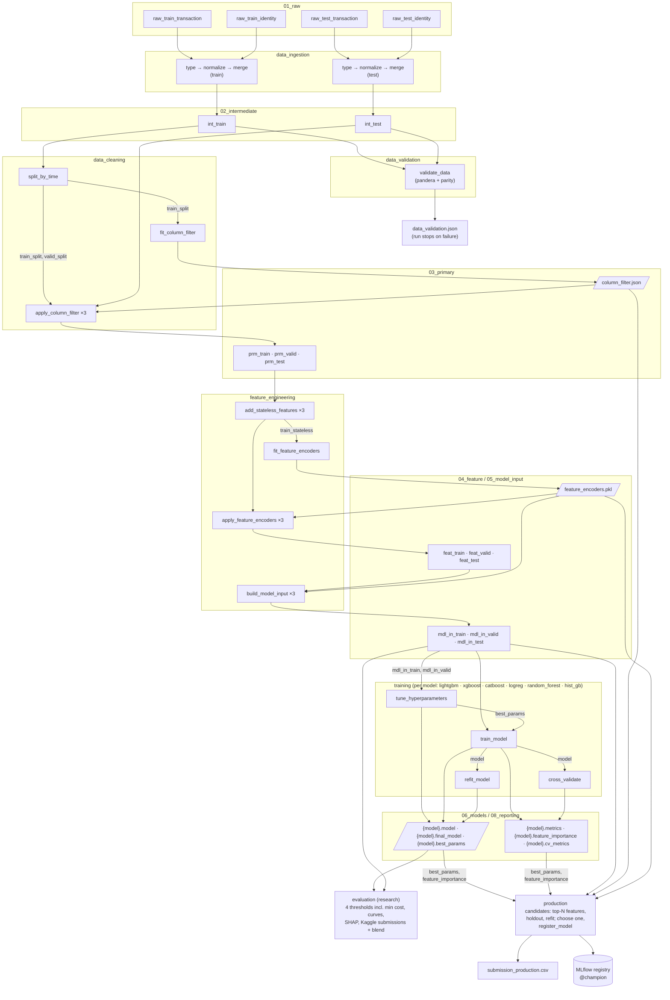
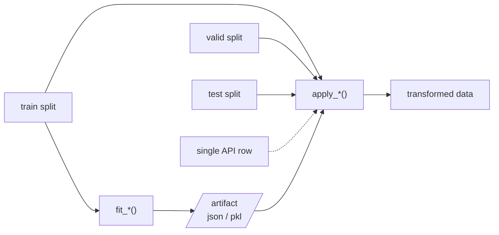
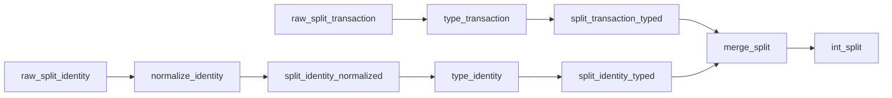
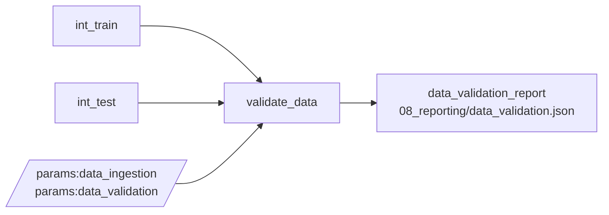
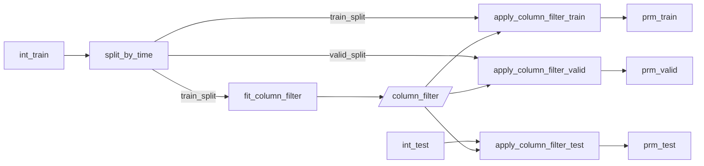
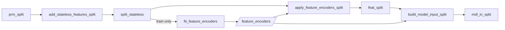
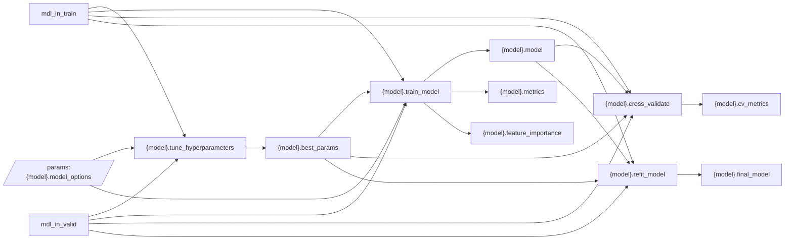
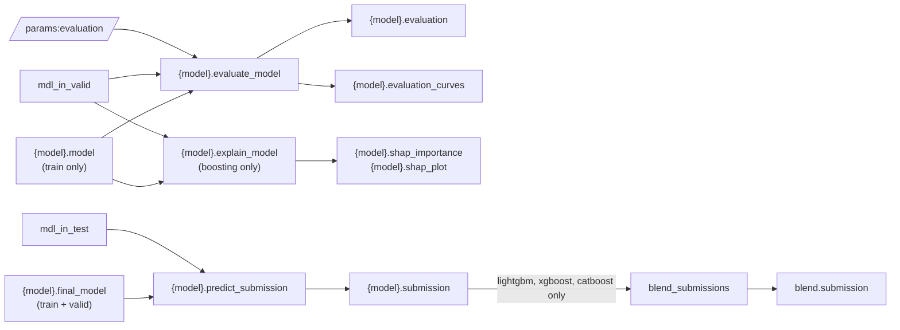
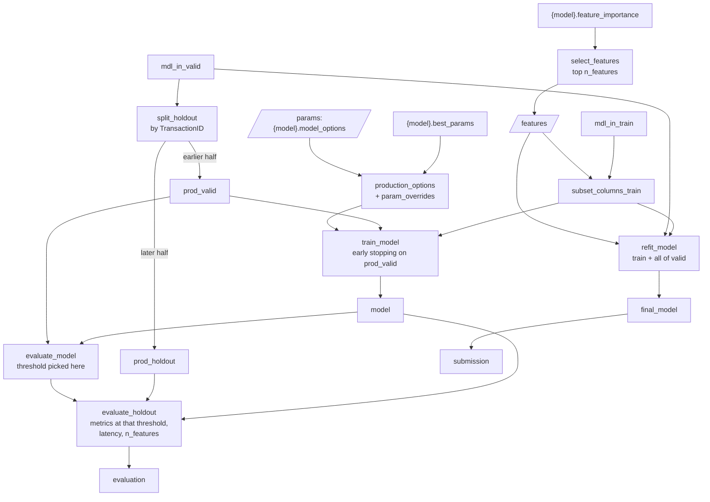
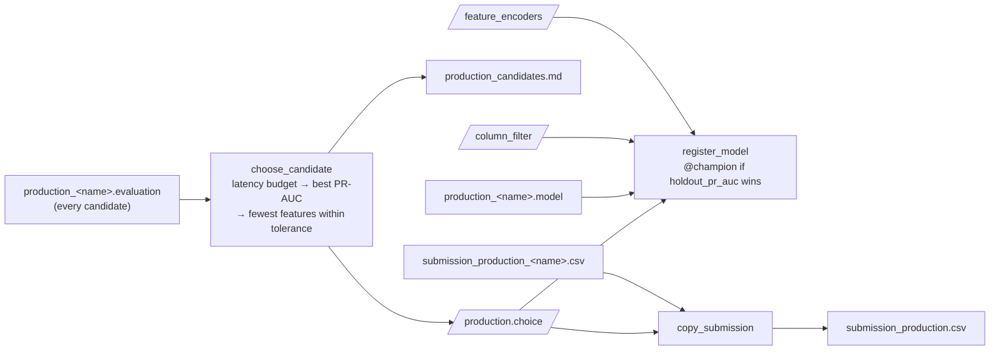

# 5. Pipelines

[← 4. Data layers](04_data_layers.md) · [Table of contents](01_introduction.md#table-of-contents)

All pipeline code lives in `src/fraud_detection/pipelines/<name>/`. Each folder contains a
`nodes.py` (plain Python functions that you can test without Kedro) and a `pipeline.py` (wires the
nodes to catalog datasets and parameters). `pipeline_registry.py` registers them.

## Registered pipelines

| Name | Status | Nodes | Run with |
|---|---|---|---|
| `data_ingestion` | Done | 8 (4 per split) | `kedro run --pipelines data_ingestion` (`make ingest`) |
| `data_validation` | Done | 1 | `kedro run --pipelines data_validation` (`make validate`) |
| `data_cleaning` | Done | 5 | `kedro run --pipelines data_cleaning` |
| `feature_engineering` | Done | 10 | `kedro run --pipelines feature_engineering` |
| `training` | Done | 24 (4 per model, 6 models) | `kedro run --pipelines training` (`make train` adds `evaluation`) |
| `training_lightgbm` / `_xgboost` / `_catboost` / `_logreg` / `_random_forest` / `_hist_gb` | Done | 4 | One model only. Not part of `__default__` |
| `evaluation` | Done | 16 (2 per model, + SHAP for the 3 boosting models, + blend) | `kedro run --pipelines evaluation` (`make evaluate`) |
| `production` | Done | 10 per candidate + 3 | `kedro run --pipelines production` (`make production`): every candidate, then the choice of the Kaggle + API model |
| `production_lightgbm_100` / `_xgboost_200` / ... | Done | 10 | One candidate (`make candidate CANDIDATE=xgboost_200`), registers nothing. Not part of `__default__` |
| `production_choose` | Done | 3 | The choice from saved candidate outputs (`make choose`). Not part of `__default__` |
| `__default__` | — | all of the above except `training_*` / `production_*` | `kedro run` (`make run`) |

Useful variations:

```bash
uv run kedro run --pipelines data_cleaning,feature_engineering   # make features
uv run kedro run --pipelines training --params "lightgbm.model_options.n_trials=0,xgboost.model_options.n_trials=0,catboost.model_options.n_trials=0"   # make train-fast
uv run kedro run --tags features            # by tag: ingestion | validation | cleaning | features | training | evaluation | production | lightgbm …
uv run kedro run --pipelines training,evaluation --namespaces logreg,random_forest,hist_gb   # make baselines
uv run kedro run --from-nodes fit_feature_encoders   # resume from a node
uv run kedro viz run                        # interactive graph of everything below
```

## Overview diagram



Parallelogram nodes (`/…/`) are **fitted artifacts**. They are learned once from the train split
and reused for every other split.

## The fit / apply pattern

Every step that *learns* something from data is split into two functions:



- `fit_*` only ever sees **train**, so valid and test scores are honest and nothing from the
  future leaks into training.
- `apply_*` is a pure function of `(data, artifact)` that works for any number of rows,
  **including one**. The test
  `tests/pipelines/test_feature_engineering.py::test_single_row_matches_batch` checks that scoring
  one row gives exactly the same features as scoring the whole table.

The full **inference chain** for new data is therefore:

```
raw rows ─► type_raw ─► apply_column_filter ─► add_stateless_features ─► apply_feature_encoders ─► build_model_input ─► FraudModel.predict_proba
          (ingestion     (column_filter)                                  (feature_encoders)        (feature_encoders)     ({model}.pkl)
           schema)
```

`InferenceBundle.predict_proba` (`src/fraud_detection/inference.py`) runs exactly this chain,
calling the pipelines' own node functions. `type_raw` replaces the ingestion pipeline for request
rows:

- it types only the columns the filter keeps;
- columns absent from the request become null;
- `has_identity` is 1 when any identity column is set, unless the client sends it explicitly.

See [7. Serving API](07_serving_api.md).

---

## data_ingestion

**01_raw → 02_intermediate.** Types each raw table against an explicit schema, aligns train and
test column names, and left-joins identity onto transactions. The same nodes run for both splits;
the target column is optional.



| Node | Function | What it does |
|---|---|---|
| `type_{split}_transaction` | `type_transaction` | Validates the columns against `schema.transaction` (fails if any column is **missing or unexpected**, which catches schema drift); `TransactionID` must be unique and non-null (→ int64); `isFraud` must be 0/1 (→ int8) if present; numerical columns → `float32` with overrides; categorical columns → `category` of strings via `to_key` |
| `normalize_{split}_identity` | `normalize_identity_columns` | `id-01` → `id_01` (the Kaggle test file uses hyphens) |
| `type_{split}_identity` | `type_identity` | Same typing for the identity schema |
| `merge_{split}` | `merge_transaction_identity` | Left join on `TransactionID` (`validate="one_to_one"`), warns about orphan identity rows, adds `has_identity` (int8) |

**Parameters** (`parameters_data_ingestion.yml`):

| Key | Value | Why |
|---|---|---|
| `schema.{table}.categorical/numerical` | lists with ranges such as `"V{1..339}"`, `"id_{01..11}"` | Expanded by `expand_columns`; zero padding is kept |
| `numerical_dtype` | `float32` | Halves memory |
| `numerical_dtype_overrides` | `TransactionDT: int64`, `TransactionAmt: float64` | Test reaches ~34M seconds, which is beyond float32's exact-integer range; keeps cents exact |

---

## data_validation



One node, `validate_data`, checks both tables with a pandera schema built from the data_ingestion
column types, then compares them. data_ingestion already fails on missing or unexpected columns
and on a target outside {0, 1}; these checks cover the rest:

| Check | Where | Rule |
|---|---|---|
| dtypes, no extra columns | both | Each column has its data_ingestion dtype (`strict=True`) |
| `TransactionID` | both | int64, unique, never null |
| Required columns | both | `required_columns` are never null (ID, time, amount, `ProductCD`) |
| Value ranges | both | `value_ranges`: `TransactionDT >= 0`, `TransactionAmt > 0` |
| `has_identity` | both | 0 or 1 |
| Time order | both | `TransactionDT` sorted ascending |
| Fraud rate | train | `isFraud` in {0, 1}, mean within `fraud_rate_range` (1–10%) |
| Same columns and dtypes | parity | test = train without the target |
| Test after train | parity | first test `TransactionDT` > last train `TransactionDT` |
| Null rates | parity | \|null share test − null share train\| ≤ `max_null_rate_diff` (0.25) per column |

Validation is lazy: every failed check is collected, then the node raises one
`DataValidationError` listing all of them (column, check, number of failures, examples). With
`fail_on_error: false` it logs a warning and continues. The report (row counts, fraud rate, the
largest train/test null-rate difference) is written when the checks pass.

On the Kaggle data every check passes in ~3 s. The largest null-rate difference is 0.14 (D13 and
some V blocks), so the 0.25 limit only catches a real break, such as a column that went missing in
one file.

In `kedro run` the node runs as soon as both tables exist, in the same step as the time split and
before anything is fitted, so a failure stops the run before the column filter, features or
models.

---

## data_cleaning

**02_intermediate → 03_primary.** Creates the time-based train/valid split and removes
uninformative columns using a filter fitted on train only.



| Node | Function | What it does |
|---|---|---|
| `split_by_time` | `split_by_time` | `day = TransactionDT // 86400`; cutoff = 80th percentile of days; split on **whole days**, so a day never ends up in both sets. Result: train days 1–140 (472,006 rows, fraud 3.51%), valid days 141–182 (118,534 rows, fraud 3.44%) |
| `fit_column_filter` | `fit_column_filter` | Rules in order, each column reported under the first rule that hits it: (1) null share > `null_threshold`; (2) most common value (including null) > `top_value_threshold`; (3) for `V` columns: group by identical null count, sort by number of unique values, and drop a column if \|corr\| > `v_correlation_threshold` with a column already kept. Protected columns and the target are never dropped |
| `apply_column_filter_{split}` | `apply_column_filter` | Keeps `kept` columns in their saved order; raises if any expected column (other than the target) is missing |

Result of the current run: **80 of 435 columns dropped** (24 by the null/top-value rules, 56
correlated `V`), **355 kept** (269 of them `V` columns). The reason for every drop is in
`column_filter.json`, for example `"V321": "|corr| > 0.95 with V320"` or
`"C3": "top value share 0.9960"`. Apart from `V` columns, only `C3` and `id_07/08/21–27` are dropped.

**Parameters** (`parameters_data_cleaning.yml`):

| Key | Value | Note |
|---|---|---|
| `train_fraction` | 0.8 | Share of days that go to train |
| `null_threshold` | 0.99 | |
| `top_value_threshold` | 0.99 | At 0.9 this rule would remove rare but predictive columns (D7, dist2, many `id_*`), and even `isFraud` itself (96.5% zeros) |
| `v_column_pattern` | `^V\d+$` | |
| `v_correlation_threshold` | 0.95 | |
| `protected_columns` | ID, time, amount, `has_identity`, and every raw column that feature_engineering uses | Prevents the filter from breaking later steps |

---

## feature_engineering

**03_primary → 04_feature → 05_model_input.**



| Node | Function | Features produced |
|---|---|---|
| `add_stateless_features_{split}` | `add_stateless_features` | Row by row, no fitting: `day`, `hour`, `weekday`; `TransactionAmt_log`, `TransactionAmt_cents`; `D{n}_norm = day − D{n}` for 14 D columns (D9 excluded: it's a fraction of a day); email parts `P_emaildomain_1/2/3`, `R_emaildomain_1/2/3`; `uid = card1_addr1_D1_norm` |
| `fit_feature_encoders` | `fit_feature_encoders` | From `train_stateless` only: **group stats** (mean/std of a value per group, kept only for groups with ≥ `min_group_size` rows); **frequency maps** (share of train rows per value); **categorical encodings** (≤100 categories → native `category`, more → integer codes); the final `feature_columns` list |
| `apply_feature_encoders_{split}` | `apply_feature_encoders` | Adds `X_to_mean_by` / `X_to_std_by` ratios (or `X_mean_by` without ratio, for the UID), `col_freq`. Unseen group → NaN, unseen value → frequency 0, unseen category → NaN |
| `build_model_input_{split}` | `build_model_input` | `TransactionID` + `isFraud` (if present) + `feature_columns` in a fixed order |

Result: 20 group features, 13 frequency columns, 37 native + 11 coded categorical columns,
**395 model features**.

**Parameters** (`parameters_feature_engineering.yml`):

| Key | Value |
|---|---|
| `d_columns` | D1–D15 without D9 |
| `uid_columns` | `[card1, addr1, D1_norm]` |
| `min_group_size` | 5 |
| `group_features` | `TransactionAmt`, `id_02`, `D15` by `card1`/`card4`/`addr1`/`addr2` (ratios), plus `TransactionAmt`, `D15` by `uid` (raw stats) |
| `frequency_columns` | `card1-3,5`, `addr1-2`, both email domains, `DeviceInfo`, `id_30/31/33`, `uid` |
| `max_native_categories` | 100 |
| `drop_columns` | `TransactionDT`, `day`, `uid`, raw D columns. Pure time, or replaced by the normalized versions |

---

## training

**05_model_input → 06_models + 08_reporting.** One *namespaced* copy of the same four-node pipeline
per model (three gradient-boosting libraries and three scikit-learn baselines). Namespacing prefixes every dataset and parameter: `lightgbm.model`,
`params:lightgbm.model_options`, and so on. Only `mdl_in_train`, `mdl_in_valid`, `params:target`
and `params:feature_engineering.join_key` are shared.



| Node | Function | What it does |
|---|---|---|
| `{model}.tune_hyperparameters` | `tune_hyperparameters` | With `n_trials: 0`, returns the base `params`. Otherwise runs an Optuna TPE search (seed 42) over `search_space`, merged on top of `params`. Each trial is fitted with early stopping on valid and scored by `tuning_metric` (`pr_auc`), stopping at `n_trials` or `timeout_minutes`. Each trial is logged as a nested MLflow run (params and metrics, no model) |
| `{model}.train_model` | `train_model` | Final fit with early stopping on valid. Computes train/valid ROC-AUC and PR-AUC, `roc_auc_gap`, `best_iteration`, `n_features`, `fit_seconds`, and feature importance (gain / impurity, or permutation importance on valid for models without a built-in one). Logged to a nested MLflow run, with the pickle as `model/model.pkl` |
| `{model}.cross_validate` | `cross_validate` | Only with `cv_folds > 0`: expanding-window time-series CV over train + valid (rows ordered by `TransactionID`). Mean ± std of ROC-AUC / PR-AUC go to `{model}_cv_metrics.json` and the model's MLflow run (`cv_*`). With `cv_folds: 0` it returns `{"cv_folds": 0}` immediately |
| `{model}.refit_model` | `refit_model` | With `refit: true`: refits on train + valid with `best_iteration × refit_iteration_multiplier` trees (no early stopping, nothing is left to stop on). Saved as `{model}_final.pkl` and used for the test submission. Logs `refit_rows`, `refit_iterations`, `refit_seconds` and the pickle (`model/final_model.pkl`) to the model's MLflow run |

`FraudModel` (`training/model.py`) wraps all six model types behind one
`fit(X, y, X_valid=None, y_valid=None, n_iterations=None)` / `predict_proba(X)` interface.
Categorical columns are passed natively to LightGBM, XGBoost (`enable_categorical`) and HistGB
(`categorical_features="from_dtype"`); for CatBoost and logistic regression (one-hot) they are
converted to strings, with `__missing__` for NaN; for random forest they become integer codes.
The `imbalance` option (`none` / `class_weight` / `undersample`) is applied inside `fit`, to the
train rows only.

**Parameters** (`parameters_training.yml`, per model):

| Key | LightGBM | XGBoost | CatBoost |
|---|---|---|---|
| `device` | cpu | cuda | GPU |
| `n_estimators` / `early_stopping_rounds` | 5000 / 200 | 5000 / 200 | 5000 / 200 |
| `n_trials` / `timeout_minutes` | 25 / 60 | 25 / 60 | 25 / 60 |
| Tuned | leaves, depth, min child samples, lr, colsample, subsample, L1/L2 | depth, lr, min child weight, subsample, colsample, L1/L2 | depth, lr, L2, random strength |

| Key | Logistic regression | Random forest | HistGB |
|---|---|---|---|
| `imbalance.method` | class_weight | none | none |
| `n_trials` | 0 | 0 | 0 |
| Main params | `C: 0.1`, one-hot `min_frequency: 100` | 300 trees, `min_samples_leaf: 50`, `max_samples: 0.5` | lr 0.05, 63 leaves, up to 2000 iterations, early stopping 50 |

All six share `imbalance`, `cv_folds: 0`, `refit: true` and `refit_iteration_multiplier: 1.2`.

---

## evaluation

**06_models + 05_model_input → 07_model_output + 08_reporting.** For each model, a namespaced
two-node pipeline (like training), plus one node that blends the boosting models.



| Node | Function | What it does |
|---|---|---|
| `{model}.evaluate_model` | `evaluate_model` | On valid, with the **train-only** model: ROC-AUC, PR-AUC, fraud rate, plus precision, recall, F1, FPR, TP/FP/FN/TN and expected cost per 1k transactions at four thresholds. **fixed**: `fixed_threshold` (0.5). **best_f1**: the threshold that maximises F1 on valid. **at_fpr**: the threshold at which FPR = `target_fpr` (1%). **min_cost**: the threshold with the lowest expected cost (below). Draws PR, ROC and cost curves with the chosen points marked. Writes everything as `eval_*` metrics and `evaluation_curves.png` into the model's **training** MLflow run |
| `{model}.explain_model` | `explain_model` | LightGBM, XGBoost and CatBoost only: SHAP values (exact TreeSHAP from the library, log-odds) on `shap.sample_size` valid rows; mean \|SHAP\| and mean SHAP per feature, a bar chart of the top `shap.top_n`. Both also go to the training MLflow run |
| `{model}.predict_submission` | `predict_submission` | Scores all test rows with the **final** (refitted) model → `TransactionID, isFraud` |
| `blend_submissions` | `blend_submissions` | Rank average (percentile ranks, mean, so the result is in 0–1) of the boosting submissions. Added only when ≥ 2 boosting models are in the pipeline; baselines stay out. Fails if the TransactionIDs don't match |

The training run is found through `FraudModel.mlflow_run_id`. Older pickles don't have it, so for
them the latest `stage = final` run of that model type is used.

**Parameters** (`parameters_evaluation.yml`):

| Key | Value | Note |
|---|---|---|
| `fixed_threshold` | 0.5 | Reference only. Weighted or undersampled models score higher, so 0.5 means something different for them |
| `target_fpr` | 0.01 | "How much fraud do we catch if we bother 1 in 100 legitimate customers?" |
| `cost.amount_column` | `TransactionAmt` | What a missed fraud costs |
| `cost.review_cost` | 5.0 | Per flagged transaction (analyst review or step-up check) |
| `cost.false_block_cost` | 15.0 | Extra per flagged legitimate transaction (support call, lost sale) |
| `shap.sample_size` / `random_state` / `top_n` | 5000 / 42 / 25 | SHAP sample from valid and features in the plot |

**Cost-based threshold.** Cost at a threshold t = `Σ TransactionAmt of missed fraud +
review_cost × flagged + false_block_cost × flagged legitimate`, where flagged means score ≥ t (as
in the API). Every distinct valid score is a candidate (plus "flag nothing"); one sort and running
sums give all totals at once. The cost figures are assumptions to agree with the business. For
LightGBM the minimum is 0.077 at $2,764 per 1k transactions, against $3,147 at 1% FPR, $3,535 at
0.5 and $5,156 with no model.

The best-F1 and min-cost thresholds are picked on valid itself, so their numbers are slightly
optimistic. The production pipeline (next section) reuses this node on its own valid part and
reports the stored threshold on a holdout.

---

## production

**Research outputs + 05_model_input → 07_model_output + MLflow registry.** The research pipelines
compare every model on all features; this one builds a few **candidates** and chooses the
**single** model used for both the Kaggle submission and the API. Candidates are listed in
`production.candidates` (name → model type + `n_features`); each gets its own pipeline in the
`production_<name>` namespace, so the `{model}.*` catalog entries write
`production_xgboost_200.pkl`, `production_xgboost_200_evaluation.json`,
`submission_production_xgboost_200.csv` and so on. The candidates are read from
`parameters_production.yml` when the pipelines are built, so adding one means editing that file
(`--params` can change a candidate, not add one).

Per candidate:



Then, over all candidates:



| Node | Function | What it does |
|---|---|---|
| `select_features` | `production/nodes.py` | Top `n_features` of the research model's importance (`null` = all). Saved to `production_<name>_features.json` |
| `production_options` | `production/nodes.py` | Research `model_options` + `best_params` + the global and the candidate's `param_overrides`; names the MLflow run `production-{model}-{n_features}` (stage `production`) |
| `subset_columns_train` / `_valid` | `production/nodes.py` | ID + target + the chosen features, for fitting only. Valid, holdout and test keep every column: `predict_proba` selects the model's own columns, and the cost metrics need `TransactionAmt` even when it is not a feature |
| `split_holdout` | `production/nodes.py` | Sorts valid by `TransactionID` (it grows with time) and keeps the last `holdout_fraction` as the holdout |
| `train_model` | reused from `training` | Fit on train, early stopping on `prod_valid`; model pickle logged to the run |
| `evaluate_model` | reused from `evaluation` | All four thresholds on `prod_valid`; `serving.threshold_metric` picks the one stored with the model |
| `evaluate_holdout` | `production/nodes.py` | ROC-AUC, PR-AUC, precision / recall / FPR / counts and cost per 1k on the holdout **at the valid threshold**, plus `n_features` and one-row `predict_proba` latency p50 / p99. Merged into the valid evaluation as `holdout_*` keys and logged to the run |
| `refit_model` | reused from `training` | Train + all of valid, `best_iteration × refit_iteration_multiplier` trees → `production_<name>_final.pkl` |
| `predict_submission` | reused from `evaluation` | `submission_production_<name>.csv` |
| `production.choose_candidate` | `production/nodes.py` | Drops the candidates above `max_latency_p99_ms`, takes the best holdout PR-AUC, and of those within `pr_auc_tolerance` the fewest features (then the higher PR-AUC). If none is fast enough it chooses among all and says so. Writes `production_choice.json` and `production_candidates.md` |
| `production.register_model` | `register_model` in `serving/nodes.py` | Logs the chosen train-only model with the column filter and encoders as one MLflow pyfunc (`InferenceBundle`), registers it as `fraud-detection` with the candidate name and feature count as tags, moves `@champion` if it wins. Outside a kedro run (tests) it only returns the summary |
| `production.copy_submission` | `production/nodes.py` | The chosen candidate's file as `submission_production.csv`, the file to upload to Kaggle |

`production_<name>` runs one candidate and registers nothing; `production_choose` runs only the
last three nodes on the saved candidate outputs (every candidate must have run once).

**Parameters** (`parameters_production.yml`):

| Key | Value | Note |
|---|---|---|
| `candidates` | `lightgbm_100`, `lightgbm_50`, `xgboost_200`, `catboost_100` | name → `{model, n_features, param_overrides?}`; names are lowercase identifiers |
| `selection.max_latency_p99_ms` | 20 | One-row model latency budget; `null` = none |
| `selection.pr_auc_tolerance` | 0.005 | Holdout PR-AUC this close to the best counts as equally good, so the fewest features win |
| `holdout_fraction` | 0.5 | Share of valid (its later days) kept as the holdout |
| `param_overrides` | `{}` | On top of the research `best_params` for every candidate, e.g. `{num_leaves: 31, max_depth: 6}` |
| `latency_rows` | 500 | Holdout rows timed one by one |

**Parameters** (`parameters_serving.yml`):

| Key | Value | Note |
|---|---|---|
| `registered_model_name` | `fraud-detection` | The name the API's `MODEL_URI` points to |
| `alias` | `champion` | The alias the API serves |
| `threshold_metric` | `min_cost_threshold` | Which valid threshold is stored with the model. Alternatives: `at_fpr_threshold`, `best_f1_threshold`, `fixed_threshold` |
| `promotion_metric` | `holdout_pr_auc` | Must be *higher is better*: the comparison is `score > champion`. A champion registered before (no `holdout_pr_auc` tag) counts as no champion |

The registered model is the chosen candidate's **train-only** model, so its threshold was picked
for it. The holdout is mostly clean, not perfectly clean: the research `best_params` and the
feature ranking were chosen on the full valid, which includes the holdout days, and choosing among
the candidates on it adds a little optimism (see
[limitations](06_modeling_approach.md#known-limitations)). The choice can prefer a smaller
candidate whose PR-AUC is slightly below the current champion's; then `@champion` stays where it
is, `serving_registration.json` says `promoted: false`, and the API keeps serving the champion
while `submission_production.csv` is the new choice. Champion and challenger are compared on the
scores stored when each was registered; that is fair only while the holdout days stay the same.

---

## Tests

| Test file | Covers |
|---|---|
| `tests/pipelines/test_data_ingestion.py` | Range expansion, column renaming, dtype casting, schema-drift and bad-target errors, the join |
| `tests/pipelines/test_data_validation.py` | Clean data passes; every failed check is reported; wrong dtype / extra column; time order and test-after-train; fraud rate range; null-rate drift; warn-only mode |
| `tests/pipelines/test_data_cleaning.py` | Time ordering of the split, each filter rule, protected columns, single-row apply, missing-column error |
| `tests/pipelines/test_feature_engineering.py` | Stateless features, native vs coded encodings, **single row = batch**, unseen values |
| `tests/pipelines/test_training.py` | All six models train on CPU and score one row; class weights and undersampling (train only); refit tree count and `refit: false`; expanding CV folds; Optuna merges params; `n_trials=0` path |
| `tests/pipelines/test_production.py` | Top-N feature selection; fitting frames keep ID + target; the holdout is the latest rows; param overrides and run name; holdout metrics use the valid threshold; the choice rule (latency budget, tolerance, fewest features, no candidate fast enough); the whole pipeline end to end with two candidates (models and refits on their features, the choice, the copied submission, the registration summary); a pipeline per candidate plus the choice; invalid candidate names |
| `tests/pipelines/test_evaluation.py` | Threshold metrics; the min-cost threshold equals a brute-force search; SHAP values add up to the prediction; SHAP ranks the signal first; submission format, rank-average blend; the blend uses only boosting models and submissions use `final_model` |
| `tests/test_inference.py` | `InferenceBundle` reproduces the batch model input and scores (single rows too); bad rows raise; the NumPy fast path equals the pandas path for every batch size and model type; pyfunc round trip; registration promotes only better models; `/explain` contributions add up to the score |
| `tests/api/test_api.py` | Liveness/readiness with and without a model, warm-up, single and batch scoring (order, size limits), threshold precedence, 422/500 error mapping, request-ID and timing headers, prediction log, `/metrics`, `/explain` |
| `tests/api/test_microbatch.py` | Off by default; concurrent requests share model calls; max batch size; one bad transaction does not fail the others; 503 without a model; the batcher survives a failing score function |
| `tests/api/test_loadtest.py` | The load-test script in-process: bodies validate against the API schemas, overload drops requests, client shares cover the schedule once |

```bash
uv run pytest      # make test
```

---
[← 4. Data layers](04_data_layers.md) · [Next: 6. Modeling approach →](06_modeling_approach.md)
