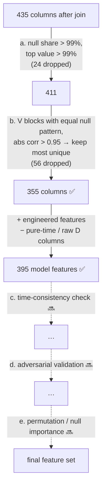

# 6. Modeling Approach

[← 5. Pipelines](05_pipelines.md) · [Table of contents](01_introduction.md#table-of-contents)

This page explains *why* the pipelines look the way they do. It covers the three hard properties
of this dataset (class imbalance, drift over time, and ~430 columns full of nulls) and how to find
the important features without investigating each column by hand.

Each technique is marked **✅ implemented** or **🔜 planned**.

## 0. Validation first

Every other decision (keep a feature, tune a parameter, pick a threshold) is judged on the
validation score. So validation must imitate production: **the model always scores transactions
newer than its training data.**

| Technique | Status |
|---|---|
| Time-based holdout: train = days 1–140, valid = days 141–182, split on whole days | ✅ `data_cleaning.split_by_time` |
| No random KFold anywhere (random folds put future fraud patterns into training) | ✅ |
| Gap of 1–2 weeks between train and valid (the real Kaggle test also starts after a gap) | 🔜 |
| Forward-chaining folds (train 1–2 → valid 3, train 1–3 → valid 4, …) for more stable estimates | ✅ optional: `cv_folds: N` → `cross_validate` (mean ± std; off by default) |
| Separate final holdout that isn't used for early stopping or tuning | 🔜 (see [limitations](#known-limitations)) |

A feature or setting that only helps under a random split is overfitting or leaking.

## 1. Class imbalance (3.5% fraud)

| Technique | Status | Note |
|---|---|---|
| Ranking metrics: **PR-AUC** (main, used for tuning) and ROC-AUC (Kaggle metric) | ✅ | Accuracy would be 96.5% for "never fraud" |
| Imbalance switch per model: `imbalance.method: none \| class_weight \| undersample` | ✅ | Default `none` (boosting, random forest, HistGB) and `class_weight` (logistic regression). Compare the options on valid PR-AUC |
| `class_weight` → each library's own setting | ✅ | LightGBM / sklearn `class_weight="balanced"`, XGBoost `scale_pos_weight = negatives / positives`, CatBoost `auto_class_weights="Balanced"` |
| `undersample` → all fraud rows + `undersample_ratio` legit rows per fraud row, **train only** | ✅ | Valid, CV valid blocks and test always keep the true distribution. Also speeds up tuning |
| No SMOTE | ✅ on purpose | Synthetic rows between neighbours rarely help tree models and don't make sense for IDs, codes and category columns |
| Cost-based decision threshold | 🔜 | Minimise `FN × TransactionAmt + FP × review_cost` on valid, instead of using 0.5 |
| Recall at a fixed FPR (1%), plus precision / recall / F1 at 0.5 and at the best-F1 threshold | ✅ `evaluate_model` | "How much fraud do we catch if we bother 1 in 100 good customers?" LightGBM: 53.7% |

## 2. Many columns and nulls: an automated funnel

The principle: **don't impute and don't inspect columns one by one.** Gradient-boosted trees
handle NaN natively (each split learns which side missing values go to), and *missingness itself
is often a signal*, for example "this transaction has no identity row". So the work becomes a
sequence of automatic filters, each one logged with a reason:



| Step | Rule | Status |
|---|---|---|
| a. Trivial drops | Null share > 0.99 or most common value > 0.99 (`null_threshold`, `top_value_threshold`) | ✅ `fit_column_filter` |
| b. **V blocks by null pattern** | The 339 `V` columns fall into 15 blocks with identical null shares. Within a block, sort by number of unique values and drop any column with \|corr\| > 0.95 to one already kept | ✅ `_reduce_correlated` |
| c. **Time-consistency check** | For each feature (or small group), train a model on the first month and score it on the last month. If valid AUC < ~0.5, the feature doesn't generalise over time → drop | 🔜 |
| d. **Adversarial validation** | Label train = 0 and test = 1 (or early = 0, late = 1) and train a classifier. Its top features are the ones that *drift* → drop or transform them | 🔜 |
| e. Importance-based pruning | **Permutation importance on valid**, or **null importance** (retrain with a shuffled target; keep features whose real importance clearly beats the shuffled distribution). Drop the bottom features and re-check valid PR-AUC | Partly: permutation importance exists (used for logreg / HistGB); `scripts/feature_size_study.py` retrains on the top-N features and measures the trade-off ([below](#how-many-features-are-needed)). An automatic pruning step is 🔜 |

Careful with importance: for the boosting models, the importance saved in
`{model}_feature_importance.csv` is **gain**-based (random forest: impurity-based; logistic
regression and HistGB have no built-in importance, so they get permutation importance on a
20k-row sample of valid). Gain is biased toward high-cardinality and noisy features, and it is measured on
*train*. Use it to explore, not to drop features. SHAP or permutation importance on valid is more
reliable.

All thresholds live in `parameters_data_cleaning.yml`, so you can tune them like hyperparameters
(e.g. try `v_correlation_threshold: 0.9`).

### Current top features (gain importance)

| Rank | LightGBM | XGBoost | CatBoost |
|---|---|---|---|
| 1 | V258 | V258 | uid_freq |
| 2 | C1 | V257 | D1_norm |
| 3 | C14 | V246 | C13 |
| 4 | D1_norm | V201 | card1_freq |
| 5 | D15_std_uid | V243 | TransactionAmt_mean_uid |

The engineered client features (`uid_freq`, `D1_norm`, `*_uid` aggregates) rank near the top in
LightGBM and CatBoost, which supports the client-level view described below.

### How many features are needed?

`scripts/feature_size_study.py` (`make feature-study`) ranks features by the full model's saved
importance and retrains the same model type on the top N (default N = all, 300, 200, 150, 100,
75, 50, 25, 10). It uses two parameter sets: **tuned** (the full model's params) and **compact**
(small trees, learning rate 0.1). For each run it records:

- valid ROC-AUC and PR-AUC, tree count, pickle size, fit time;
- **model** latency: one row through `FraudModel.predict_proba`, p50 and p99;
- **end-to-end** latency: one raw row through `InferenceBundle`, the same path as the API, p50 and p99;
- batch throughput in rows per second.

Output: `data/08_reporting/feature_size_study_{model}.{csv,md,png}`.

So far only one configuration has been run (LightGBM, compact, top 10 features): valid PR-AUC
0.464 vs 0.614 for the full model; model latency p50 3.7 ms; **end-to-end latency p50 576 ms**.
That 576 ms was the pandas feature path, not the model; the API now uses the NumPy fast path
(~2 ms per row with all 395 features, see [7. Serving API](07_serving_api.md#latency)), and the
study times that path. Feature count is therefore an accuracy / maintenance choice, not a latency
one. Run the full study before choosing it.

## 3. Change over time (drift)

Fix drifting features where possible, and drop them only when you can't:

| Technique | Status | Where |
|---|---|---|
| Don't use `TransactionDT` or `day` as features (pure time; test days are never seen in train) | ✅ | `drop_columns` |
| **D-normalisation**: `D_n_norm = day − D_n`. "Days since the card was first seen" grows every day; "the day the card was first seen" stays constant for a client | ✅ | `add_stateless_features` |
| Encoders fitted on **train only**, so the API (single rows) gets exactly the same values | ✅ | `fit_feature_encoders` |
| **Client UID** `card1 + addr1 + D1_norm` with aggregates (`TransactionAmt_mean_uid`, `D15_std_uid`, `uid_freq`). Fraud is tied to *clients*: once a card is compromised, all its transactions are fraud | ✅ | `uid_columns`, `group_features` |
| Watch the train–valid gap (`roc_auc_gap` in metrics) | ✅ | `train_model` |
| Adversarial validation to find the remaining drifting features | 🔜 | see funnel step d |
| Frequency encoding computed per period, or on train + test, if counts shift between periods | 🔜 | Trade-off: a single API row has no "period", so this needs a stored reference |
| Monitoring in production (score distribution, feature PSI) and periodic retraining | 🔜 | |

## 4. Models and tuning

| Choice | Reason |
|---|---|
| Gradient-boosted trees (LightGBM, XGBoost, CatBoost) | Best for wide tabular data with NaNs and mixed types; native categorical support |
| Three libraries side by side | Same input and metrics, so MLflow shows the trade-offs directly. LightGBM currently leads (baseline valid PR-AUC 0.614) |
| **Baselines**: logistic regression, random forest, scikit-learn HistGradientBoosting | Answers "how much does boosting actually add?". Same input, metrics and MLflow runs. Untuned by default |
| Optuna TPE, 25 trials / 60 min per boosting model, tuning metric PR-AUC | Cheap, reproducible (seed 42) |
| Early stopping (200 rounds) on valid, up to 5000 trees | Finds the number of trees automatically |
| **Refit on train + valid** for the submission, with `best_iteration × 1.2` trees | The valid days are the closest to test; a train-only model never learns from them. 1.2 because there is ~25% more data |
| Rank-average **blend** of the boosting models | Different libraries make partly different mistakes. Baselines stay out of it so they don't pull it down |
| Categories ≤ 100 native, larger ones as integer codes | High-cardinality native categories overfit and slow training |

### Baselines

| Model | How it sees the data |
|---|---|
| `logreg` | Median imputation + missing-value indicators, standard scaling, one-hot for the native categorical columns (categories with < 100 train rows grouped as "infrequent"). High-cardinality columns arrive as integer codes and are used as plain numbers, which is meaningless for a linear model; their frequency encodings (`*_freq`) carry the useful part. `class_weight` by default, which matters far more for a linear model than for trees |
| `random_forest` | Native NaN support (sklearn ≥ 1.4); category columns become integer codes. 300 trees, `min_samples_leaf: 50`, each tree on a 50% row sample to keep training time and pickle size down |
| `hist_gb` | Native NaN and categorical support (`categorical_features="from_dtype"`). Early-stops on valid ROC-AUC after 50 rounds without improvement. CPU only |

Run them alone with `make baselines`, or one at a time with `kedro run --pipelines training_logreg`.

### Results so far (base params, valid days 141–182)

| Model | ROC-AUC | PR-AUC | Precision / recall @ 0.5 | Best F1 (threshold) | Recall @ 1% FPR | Train–valid gap |
|---|---|---|---|---|---|---|
| LightGBM | **0.9315** | **0.6137** | 0.81 / 0.45 | **0.596** (0.36) | **0.537** | 0.068 |
| XGBoost | 0.9292 | 0.6117 | 0.84 / 0.42 | 0.589 (0.26) | 0.531 | 0.067 |
| HistGB | 0.9197 | 0.5910 | 0.79 / 0.43 | 0.583 (0.33) | 0.524 | 0.072 |
| CatBoost | 0.9056 | 0.5449 | 0.80 / 0.39 | 0.548 (0.37) | 0.467 | 0.065 |
| Random forest | 0.8884 | 0.4482 | 0.84 / 0.23 | 0.465 (0.25) | 0.387 | 0.064 |
| Logistic regression | 0.8361 | 0.1958 | 0.13 / 0.70 | 0.340 (0.83) | 0.017 | 0.053 |

What the numbers say:

- **Boosting earns its place, but not by much over plain boosting.** HistGB, untuned and without
  any library extras, is only 0.02 PR-AUC behind LightGBM. The big jump is from linear and bagging
  models to boosting.
- **At 0.5, every tree model is precise but misses more than half the fraud.** The best-F1
  thresholds sit at 0.26–0.37, which is why the threshold must be chosen deliberately.
- **Logistic regression's probabilities are not comparable.** `class_weight` pushes its scores up:
  at 0.5 it flags far too much (precision 0.13), and many legitimate rows score near 1.0, so at a
  1% FPR it catches almost nothing (0.017). That reflects a poor ranking at the top of the score
  scale, plus the inflated probabilities (see limitation 5).
- **CatBoost** needs tuning most: it is the weakest boosting model and runs the most trees.

### Refit and which model produces what

| Output | Model |
|---|---|
| `{model}_metrics.json`, `{model}_evaluation.json`, curves, CV | `{model}.pkl`: trained on train only, early-stopped on valid |
| `submission_{model}.csv`, blend | `{model}_final.pkl`: refitted on train + valid (or the same model when `refit: false`) |

The refitted model has no score of its own: nothing is left to score it on. That's the usual
trade-off, and the reason the tree count is copied from the validated model instead of chosen
again.

## 5. Hyperparameters explained

All values live in `conf/base/parameters_training.yml`, one block per model. Each block has
**run options** (how training runs), **`params`** (passed to the library: the base values) and a
**`search_space`** (ranges Optuna samples from, merged on top of `params`).

### Run options (same for every model)

| Option | Value | What it does |
|---|---|---|
| `model_type` | `lightgbm` / `xgboost` / `catboost` | Which library `FraudModel` wraps |
| `device` | `cpu` / `cuda` / `GPU` | Where trees are built. LightGBM's pip build is CPU-only |
| `n_estimators` | 5000 | Upper limit on the number of trees. Never reached in practice: early stopping ends sooner |
| `early_stopping_rounds` | 200 | Stop when valid AUC has not improved for 200 trees; keep the best tree count (`best_iteration`) |
| `log_every` | 500 | Print valid AUC every 500 trees (in `logs/info.log`) |
| `tuning_metric` | `pr_auc` | What Optuna maximises on valid. PR-AUC focuses on the 3.5% fraud class; ROC-AUC is also logged |
| `n_trials` | 25 | Optuna trials per model. `0` skips tuning and trains once with `params` |
| `timeout_minutes` | 60 | Stops tuning early if the trials take longer than this |
| `imbalance.method` | `none` | `none`, `class_weight` or `undersample` (see [class imbalance](#1-class-imbalance-35-fraud)) |
| `imbalance.undersample_ratio` | 5 | Legit rows kept per fraud row when undersampling |
| `cv_folds` | 0 | `N > 0` runs expanding-window time-series CV over train + valid with N folds after the final fit; mean ± std goes to `{model}_cv_metrics.json` and the model's MLflow run. Multiplies training time by up to N |
| `refit` | `true` | Refit on train + valid for the submission |
| `refit_iteration_multiplier` | 1.2 | Trees in the refit = `best_iteration` × this |

Override any of them from the CLI, for example:

```bash
kedro run --pipelines training_lightgbm,evaluation --params "lightgbm.model_options.imbalance.method=class_weight"
kedro run --pipelines training_xgboost --params "xgboost.model_options.cv_folds=5"
```

### The ideas behind the parameters

Gradient boosting adds small trees one after another; each new tree corrects the errors of the
ones before it. Almost every parameter controls one of four things:

| Lever | Parameters | Higher value means |
|---|---|---|
| **Step size** | `learning_rate` | Each tree changes the prediction more → fewer trees needed, but coarser and easier to overfit. Lower is usually better but slower |
| **Tree size** (complexity) | `num_leaves`, `max_depth`, `depth` | Each tree can learn more detailed patterns → more power, more overfitting |
| **Minimum evidence per leaf** | `min_child_samples`, `min_child_weight` | A leaf needs more data → simpler, more stable trees, less overfitting |
| **Randomness** (decorrelates trees) | `subsample`, `colsample_bytree`, `random_strength` | Lower sampling fractions (or higher strength) → more randomness, less overfitting, slightly lower fit |
| **Penalties** | `reg_alpha` (L1), `reg_lambda` / `l2_leaf_reg` (L2) | Leaf values are shrunk towards 0 → smoother model, less overfitting |

The current ~0.07 train–valid gap (train ROC-AUC up to 0.999) says the base values sit on the
"too complex" side: smaller trees, more evidence per leaf and stronger penalties are the first
things to try, and the search spaces below include them.

### LightGBM

| Parameter | Base | Search range | Meaning |
|---|---|---|---|
| `objective` | `binary` | — | Binary classification with log loss |
| `boosting_type` | `gbdt` | — | Classic gradient boosting |
| `num_leaves` | 256 | 31–512 (log) | Max leaves per tree. LightGBM grows trees leaf-wise, so this is the **main complexity knob**. 256 is large |
| `max_depth` | 13 | 6–16 | Depth cap, a safety limit on top of `num_leaves` |
| `min_child_samples` | 79 | 20–300 (log) | Min rows in a leaf. Higher = less overfitting on rare patterns |
| `learning_rate` | 0.03 | 0.02–0.1 (log) | Step size per tree |
| `subsample` | 0.9 | 0.6–1.0 | Share of rows used per tree (bagging) |
| `subsample_freq` | 3 | — | Re-draw the row sample every 3 trees (bagging is off when this is 0) |
| `colsample_bytree` | 0.9 | 0.3–1.0 | Share of features each tree may use. With ~400 correlated features, lower values often help |
| `reg_alpha` | 0.3 | 0.001–10 (log) | L1 penalty on leaf values; can zero out weak leaves |
| `reg_lambda` | 0.3 | 0.001–10 (log) | L2 penalty on leaf values; shrinks them smoothly |
| `random_state` | 42 | — | Seed for reproducible sampling |
| `n_jobs` | -1 | — | Use all CPU threads |
| `verbosity` | -1 | — | Silence LightGBM's own console output (progress comes through `log_every`) |

### XGBoost

| Parameter | Base | Search range | Meaning |
|---|---|---|---|
| `objective` | `binary:logistic` | — | Binary classification, outputs probabilities |
| `tree_method` | `hist` | — | Histogram-based tree building; required for GPU and categorical support |
| `max_depth` | 9 | 4–14 | Depth of each tree. XGBoost grows level by level, so this is its **main complexity knob** (a depth-9 tree has up to 512 leaves) |
| `learning_rate` | 0.03 | 0.02–0.1 (log) | Step size per tree |
| `min_child_weight` | 1 | 0.5–50 (log) | Min "evidence" (sum of hessians ≈ rows weighted by uncertainty) in a leaf. Higher = more conservative |
| `subsample` | 0.9 | 0.6–1.0 | Share of rows per tree |
| `colsample_bytree` | 0.5 | 0.3–1.0 | Share of features per tree |
| `reg_alpha` | 0.3 | 0.001–10 (log) | L1 penalty on leaf values |
| `reg_lambda` | 1.0 | 0.01–10 (log) | L2 penalty on leaf values (XGBoost's default is 1) |
| `max_cat_to_onehot` | 1 | — | Categorical splits group categories (partition) instead of one-hot, the better choice for 3+ categories |
| `max_bin` | 256 | — | Bins per numeric feature for the histogram. More bins = finer splits, more memory |
| `random_state` | 42 | — | Seed |

Set by the wrapper, not in YAML: `enable_categorical=True` (use the pandas `category` columns
directly), `eval_metric="auc"`, `device` from the run options.

### CatBoost

| Parameter | Base | Search range | Meaning |
|---|---|---|---|
| `depth` | 8 | 4–10 | Depth of each tree. CatBoost builds **symmetric** trees (same split at every node of a level), which regularise by design; 6–8 is typical |
| `learning_rate` | 0.05 | 0.02–0.15 (log) | Step size per tree |
| `l2_leaf_reg` | 3.0 | 0.5–30 (log) | L2 penalty on leaf values (CatBoost's default is 3) |
| `random_strength` | default (1) | 0.1–10 (log) | Noise added to split scores, so the model does not always pick the same best split. Higher = more randomness |
| `border_count` | 254 | — | Bins per numeric feature (CatBoost's `max_bin`). 254 is the GPU maximum for good accuracy |
| `random_seed` | 42 | — | Seed |

Set by the wrapper: `cat_features` (the `category` columns, with nulls as `"__missing__"`),
`eval_metric="AUC"`, `task_type` from `device`, `use_best_model=True`.

CatBoost's strength is its own encoding of categorical columns (ordered target statistics). It
is currently the weakest model at base settings (valid ROC-AUC 0.906 vs 0.93) and has run far
more trees (1597), which suggests its learning rate or depth are off; it should gain the most
from tuning.

### How Optuna searches

- **TPE sampler** (seed 42): the first trials are random; later ones focus on regions where
  earlier trials scored well.
- **"log"** means values are sampled evenly on a log scale: 0.01–0.1 is explored as much as
  0.1–1, which suits parameters that matter by order of magnitude (learning rate, penalties).
- Each trial is a full fit with early stopping, so trial time depends on how many trees it needs.
  A high `learning_rate` trial finishes fast; a low one can take minutes.
- Every trial is logged as a nested MLflow run under `<model>-tuning`: select them and use
  **Compare** → parallel coordinates plot to see which parameters drive `valid_pr_auc`.
- The best trial's parameters go to `data/06_models/<model>_best_params.json`, and the final
  model is fitted with them.

## Known limitations

1. **Optimistic validation score.** Early stopping already picks the number of trees on the valid
   split, and Optuna will also score on it once tuning runs. So the reported valid score is
   slightly optimistic. Fix: a third, later holdout (e.g. the last
   2–3 weeks) used only for the final report, or forward-chaining folds.
2. **Train–valid gap of ~0.07 ROC-AUC** for all models (LightGBM train ROC-AUC 0.999). This
   suggests overfitting (256 leaves, depth 13) and/or remaining drift. Try stronger
   regularisation, plus funnel steps c–e.
3. **No gap between train and valid**, while the real test set starts after a gap. Client
   aggregates may therefore look more useful in validation than they will be in production.
4. **CV folds split by row order, not by whole days.** `cross_validate` orders rows by
   `TransactionID` (which grows with time) because the model input no longer has
   `TransactionDT`. A fold boundary can fall inside a day; the effect is negligible.
5. **Undersampling and class weights inflate the probabilities.** Ranking metrics are fine, but
   `fixed_threshold: 0.5` and the best-F1 threshold are not comparable between a weighted and an
   unweighted model.
6. **The best-F1 threshold is picked on valid itself**, so the `best_f1_*` numbers are
   optimistic. A cost-based threshold should be chosen on one period and checked on a later one.
7. **Encoders don't see clients that are new in valid or test.** Their UID stats are NaN, which
   is honest, but it means production performance depends on how often clients come back.

---
[← 5. Pipelines](05_pipelines.md) · [Next: 7. Serving API →](07_serving_api.md)
