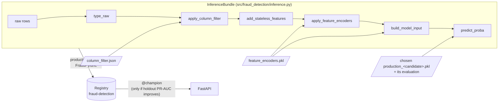
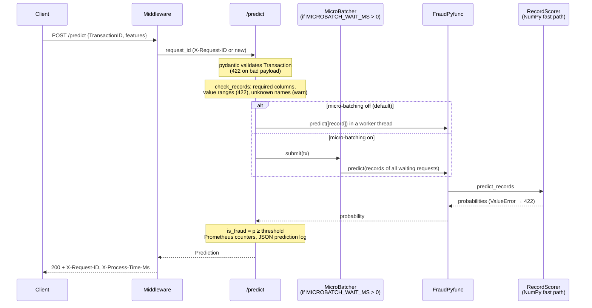

# 7. Serving API

[← 6. Modeling approach](06_modeling_approach.md) · [Table of contents](01_introduction.md#table-of-contents)

The scoring service is a FastAPI app in `src/fraud_detection/api/`. At startup it loads one model
from the MLflow registry, pinned to a concrete version, and returns a fraud probability and a
decision for each transaction.

## How a model reaches the API



1. `InferenceBundle` chains the **same node functions** as the batch pipelines. `type_raw` applies
   the data_ingestion typing rules (categorical keys via `to_key`, dtypes, `id-01` → `id_01`) to
   the columns the column filter keeps. Lookup tables are converted to indexed Series once, which
   gives identical results and avoids re-hashing 100k-key dicts on every request.
2. The `production` pipeline (`make production`) trains a few candidates (a model type with its
   research params on its top-N features), reports each on a holdout and chooses one: within
   the latency budget, best holdout PR-AUC, fewest features among the near-best (see
   [README](../README.md#research-vs-production)). It wraps the chosen one in the bundle as an
   MLflow pyfunc and registers it as `fraud-detection`. It stores in the model metadata:
   - the decision **threshold**: `serving.threshold_metric`, default `min_cost_threshold` (the
     lowest expected cost on valid, see `evaluation.cost`; `at_fpr_threshold` flags ~1% of
     legitimate transactions instead), with its `cost_per_1k`;
   - the model type, the candidate name and its number of features;
   - holdout PR-AUC (`holdout_pr_auc`, from rows the model was never fitted or tuned on).
3. `@champion` moves to the new version only if its `serving.promotion_metric` beats the current
   champion's. The result is written to `data/08_reporting/serving_registration.json`.

The registered model is the chosen candidate's **train-only** model, so the threshold and metrics
stored with it describe exactly that model. The Kaggle submission uses the same candidate
refitted on all labelled data. The API needs no change for the smaller feature set: the bundle builds every
feature and the model selects its own columns (`FraudModel.feature_columns`).

**Parity** is tested in `tests/test_inference.py`: raw rows sent the way the API sends them
(missing keys, numbers as strings) produce exactly the batch model input. On real data, 3,001 raw
CSV rows reproduce `05_model_input/valid.parquet` exactly (395 columns, identical probabilities).

**Two paths, same scores.** `FraudPyfunc.predict` takes either form of raw rows:

| Input | Path | Used by | 1 row | 1000 rows |
|---|---|---|---|---|
| `pd.DataFrame` | `InferenceBundle.predict_proba`: the batch node functions | pipelines, notebooks | ~150 ms | ~220 ms |
| `list[dict]` | `InferenceBundle.predict_records`: NumPy fast path (`fast_inference.py`) | the API | ~2 ms | ~110 ms |

The pandas path pays a fixed ~0.1–1 ms per pandas call, thousands of calls per request, whatever
the row count. The fast path (`RecordScorer`) does the same steps on NumPy arrays: one float64
cast of all numerical columns (validating every value, as `type_raw` does), one cast per storage
dtype, `to_key` per value, plain dict lookups for the fitted encoders, and only the features the
model reads. LightGBM gets the float matrix directly (categories as the codes LightGBM itself would
use); other model types get a DataFrame with category dtypes. Tests check that both paths give
bit-identical features and scores, for any batch size and for every model type; on 2,000 real raw
rows all 395 features and all scores are identical.

One deliberate difference: the fast path keys every value on its own, so `card1` sent as `1001`,
`1001.0` or `"1001"` is the same category, as in training. The pandas path keys a column by its
dtype in the request, so a column mixing strings and floats keys `315.0` as `"315.0"`.

## Endpoints

| Method | Path | Response | Notes |
|---|---|---|---|
| `GET` | `/health/live` | `{"status": "ok"}` | Process is up. Docker `HEALTHCHECK` |
| `GET` | `/health/ready` | `Health` | 503 until a model is loaded: route traffic on this |
| `GET` | `/health` | `Health` | Back-compat, always 200 |
| `POST` | `/predict` | `Prediction` | One transaction |
| `POST` | `/predict/batch` | `list[Prediction]` | 1–1000 transactions, one model call, request order kept |
| `POST` | `/explain?top_k=10` | `Explanation` | One transaction: the `Prediction` plus the `top_k` (1–50) features with the largest \|SHAP\|, each with its value (categories as labels) and SHAP value in log-odds. ~110 ms per row instead of ~2 ms, so it is a separate endpoint and `/predict` is unchanged. 501 if the model cannot explain |
| `GET` | `/metrics` | Prometheus | HTTP metrics, `fraud_prediction_probability`, `fraud_predictions_total{model_version,is_fraud}` |
| `GET` | `/docs` | Swagger UI | |

Errors: 503 when no model is loaded; 422 for invalid payloads or input the model rejects
(e.g. `TransactionDT` missing); 500 otherwise. Every response carries `X-Request-ID` (echoed or
generated) and `X-Process-Time-Ms`. Each prediction is logged as one JSON line on the
`fraud_detection.api.predictions` logger, for drift monitoring and joining fraud labels later.

### Life of a request



At startup the lifespan handler resolves `MODEL_URI` (e.g. `@champion`) to a fixed version, reads
the threshold from the model metadata (unless `FRAUD_THRESHOLD` is set) and scores one dummy row,
so the first real request does not pay for building the fast path. The model is never reloaded
while the process runs: after `@champion` moves, restart the API (or roll the containers).

### Request: `Transaction`

```json
{
  "TransactionID": 3663549,
  "features": {
    "TransactionDT": 18403224,
    "TransactionAmt": 31.95,
    "ProductCD": "W",
    "card1": 10409,
    "addr1": 315,
    "P_emaildomain": "gmail.com"
  }
}
```

`features` holds the **raw** transaction and identity columns, named as in the Kaggle files.
Absent columns are treated as null. `has_identity` is derived (1 if any identity column is set)
unless sent.

Before scoring, `FraudPyfunc.check_records` applies the same rules `data_validation` applies to
the batch tables (`required_columns` and `value_ranges` from `parameters_data_validation.yml`,
stored in the model bundle at registration):

| Input | Response |
|---|---|
| A required column (`TransactionDT`, `TransactionAmt`, `ProductCD`) absent or null | **422**, e.g. `Invalid input: TransactionAmt is required (TransactionID 3)` |
| A value outside its range (`TransactionAmt > 0`, `TransactionDT ≥ 0`) or not a number | **422**, e.g. `Invalid input: TransactionAmt must be > 0, got -5 (TransactionID 3)` |
| A column name no raw table defines (typo, extra client field) | **200**, scored with that column treated as missing. Counted in `fraud_unknown_columns_total`, and a warning is logged the first time each name shows up in a worker |

Invalid values are rejected rather than scored: the model never saw them in training, so its
score for them would mean nothing. Unknown names are not rejected, so a client that sends extra
fields keeps working. A misspelled feature, though, is scored as if missing; alert on
`rate(fraud_unknown_columns_total[5m]) > 0`. Models registered before this check existed have no
stored rules and get only the unknown-column check.

### Response: `Prediction`

```json
{
  "TransactionID": 3663549,
  "fraud_probability": 0.0142,
  "is_fraud": false,
  "threshold": 0.273,
  "model_version": "2",
  "model_uri": "models:/fraud-detection/2"
}
```

## Configuration

| Env variable | Default | Meaning |
|---|---|---|
| `MODEL_URI` | `models:/fraud-detection@champion` | Alias, version (`models:/fraud-detection/3`) or `runs:/<id>/...`; an alias is resolved to a version at startup |
| `FRAUD_THRESHOLD` | unset | Overrides the threshold stored with the model. Keep it unset (`.env.example` leaves it commented out) unless you mean to bypass the cost-optimal threshold |
| `MLFLOW_TRACKING_URI` | — (compose: `http://mlflow:5000`, local: `sqlite:///mlflow.db`) | Where the registry lives |
| `WEB_CONCURRENCY` | `4` (Docker) | uvicorn worker processes; about one per core given to the container. `make api-prod WORKERS=n` locally |
| `OMP_NUM_THREADS` | `1` (Docker, `api-prod`) | One thread per worker; scale with workers |
| `MICROBATCH_WAIT_MS` | `0` (off) | > 0 turns on micro-batching of `/predict`: wait up to this long to score concurrent requests together (see [Scaling](#scaling)) |
| `MICROBATCH_MAX_SIZE` | `64` | Most transactions per micro-batch |
| `LOG_LEVEL` | `INFO` | `WARNING` silences per-request / per-prediction logs |

## Running it

```bash
make production                                                   # candidates, choose, register + maybe promote
MLFLOW_TRACKING_URI=sqlite:///mlflow.db make api                  # http://localhost:8000/docs
MLFLOW_TRACKING_URI=sqlite:///mlflow.db make api-prod WORKERS=8   # several workers, as in Docker
MICROBATCH_WAIT_MS=2 make api-prod                                # ... with micro-batching on
make docker-up                                                    # Postgres + MLflow + API
make loadtest                                                     # full grid below, ~15 min
make loadtest REQUESTS=1000 BATCHES=1                             # one scenario
make loadtest REQUESTS=10000 BATCHES=1 CLIENTS=4                  # 4 client processes
```

## Load test

`scripts/loadtest.py` is an **open-loop** async test: a scenario sends R requests of B
transactions each, evenly over one minute. Request i leaves at i × 60 / R seconds whether or not
the earlier ones answered, so latency includes queueing when the API falls behind (a closed loop,
which waits for each answer, would hide that). B = 1 goes to `/predict`, B > 1 to `/predict/batch`.

- Grid: R ∈ {1, 10, 1000, 10000} requests per minute × B ∈ {1, 10, 100, 1000} transactions.
- Payloads: real raw rows from `data/01_raw` (transaction + identity, nulls left out), the shape
  a client sends; synthetic rows if the files are missing.
- More than `--max-in-flight` (256) unanswered requests: new ones are dropped and counted, so an
  overloaded API cannot exhaust the client.
- Report: `data/08_reporting/loadtest.{csv,md}`: sent / ok / errors / dropped, achieved req/s
  and rows/s, client p50/p95/p99/max, server time (`X-Process-Time-Ms`), ms per row. Budget
  p99 < 50 ms is checked for B = 1; the exit code is 1 if a single-transaction scenario fails it.
- `--clients N` splits each scenario over N client processes (interleaved schedules, results
  merged). One asyncio client process tops out around 150 requests per second, so above that a
  single client measures itself, not the API.

`tests/api/test_loadtest.py` runs the same code in-process (ASGI transport, fake model) on a
scaled-down grid, checks that every generated body validates against `Transaction` /
`TransactionBatch`, that overload drops requests instead of queueing them, and that client
shares cover the schedule exactly once and merge correctly.

## Latency

With the pandas path, one row took ~150–225 ms: ~400 columns went through thousands of pandas
calls at ~0.1–1 ms each, while the 531 trees take ~0.3 ms. The API now uses the NumPy fast path
(see [Parity](#how-a-model-reaches-the-api)): **~2 ms per row in-process** (features ~0.5 ms,
model ~0.3 ms, the rest the numerical cast), 1000 rows ~110 ms.

Load test, one uvicorn worker, LightGBM champion v2, client and API on the same Windows laptop
(`data/08_reporting/loadtest.md`; the 1 and 10 per minute rows are from the rerun with connection
reuse, `loadtest_low_rate.md`):

| Requests / min | Rows / request | Client p50 / p99 | Server p50 | Result |
|---|---|---|---|---|
| 1–10 | 1 | 10 / 15 ms | ~4 ms | **pass** (p99 < 50 ms) |
| 1000 | 1 | 11 / 13 ms | 5 ms | **pass** |
| 10000 | 1 | 3.1 s / 18 s | 34 ms | overload, but mostly of the single client process (see [Scaling](#scaling)) |
| 1000 | 10 | 15 / 49 ms | 9 ms | ok, 167 rows/s |
| 1000 | 100 | 48 / 407 ms | 39 ms | ok, 1,667 rows/s, queueing in the tail |
| 10 | 1000 | 230 / 343 ms | ~200 ms | ok |
| 1000–10000 | 100–1000 | timeouts | — | overload (17k–170k rows/s asked) |

Reading it:

- **Single transactions meet the budget** at 1000 requests per minute on one worker. At 10000
  per minute (167 req/s) the run above was limited by its single client process; see
  [Scaling](#scaling) for the runs with several clients and workers.
- **Batches are the cheap way to throughput**: ~0.2–0.4 ms per row at 100–1000 rows, ~3–5k rows/s
  per worker. A 1000-row batch spends ~110 ms scoring and the rest parsing JSON, validating with
  pydantic and writing 1000 prediction log lines (`LOG_LEVEL=WARNING` turns those off).
- The top-right of the grid (1000+ batches of 100–1000 rows per minute) is 10–100× one worker's
  capacity; it ends in client timeouts, and the API keeps working through the abandoned backlog
  for a few minutes. That is a sizing limit, not a bug.
- On Windows, point the client at `127.0.0.1`, not `localhost`: each new connection to
  `localhost` tried IPv6 first and cost ~2 s here, which made the first run of the 10 per minute
  scenarios look like 266 ms.

### Latency per model type

The numbers above are for the LightGBM champion. `scripts/serving_latency.py`
(`make serving-latency`) times every saved model (`data/06_models/{model}.pkl`, all 395
features) one row at a time, in-process. Its output is `data/08_reporting/serving_latency.csv`.
p50 in ms:

| Model | Pandas path | NumPy fast path | Fast path, 1 thread | Model only, 1 thread |
|---|---|---|---|---|
| **LightGBM** | 166 | 2.0 | **0.8** | 7.6 |
| CatBoost | 110 | 19 | 18 | 12 |
| XGBoost | 172 | 51 | 22 | 14 |
| HistGB | 185 | 66 | 24 | 15 |
| Random forest | 138 | 61 | 26 | 20 |
| Logistic regression | 114 | 40 | 38 | 33 |

- **LightGBM is the only model that stays NumPy end to end.** `RecordScorer` passes it the float
  matrix directly. Every other model type gets a pandas DataFrame with category dtypes rebuilt
  from that matrix, and the rebuild plus the library's own DataFrame handling costs 10–35 ms.
  That is also why LightGBM's "model only" time on a DataFrame (7.6 ms) is higher than its whole
  fast path.
- **Threads slow down single rows.** With the default thread settings (`n_jobs=-1`, OpenMP), each
  call starts a thread pool for one row. One thread is 2–3× faster for XGBoost, HistGB and random
  forest; CatBoost and logistic regression barely change. The API does not set this yet: a
  single-row service should score with one thread, and batch scoring can keep all cores.
- **The number of features matters less than either.** On the
  [feature-count study](06_modeling_approach.md#how-many-features-are-needed), going from 395 to
  100 features roughly halves the DataFrame-path model time, but it does not touch the
  pandas-vs-NumPy gap.

Measured on the same Windows laptop as the load test (32 threads). One-off runs vary by ±30%, so
compare models within one run.

## Scaling

Scoring is CPU work, and Python runs CPU work in one thread at a time per process, so **async or
threads alone do not add throughput**. The endpoints are plain `def` (FastAPI runs them in a
thread pool); `async` matters on the client side, which is why the load test is async.

Two levers, both configuration only:

1. **Worker processes** (the main one): `WEB_CONCURRENCY` in Docker (default 4), `--workers` /
   `make api-prod WORKERS=n` locally; about one per core. Each worker loads its own copy of the
   model (a few hundred MB). Beyond one machine: more containers behind a load balancer, scaled on
   CPU. With several workers, Prometheus needs `PROMETHEUS_MULTIPROC_DIR` so `/metrics` adds up
   all workers (set in Docker and `api-prod`).
2. **Micro-batching** (optional, off by default): `MICROBATCH_WAIT_MS` > 0. `/predict` hands its
   transaction to a `MicroBatcher` (`api/microbatch.py`) that collects concurrent requests for up
   to that many ms (or `MICROBATCH_MAX_SIZE`) and scores them in one model call; each request
   still gets its own response. If the combined call rejects the input, each transaction is
   rescored alone, so only the bad one gets its 422. Tests: `tests/api/test_microbatch.py`.

Measured on the development laptop (32 logical cores, Windows), 10000 single transactions per
minute, client processes on the same machine:

| Workers | Micro-batching | Clients | Result over repeated runs |
|---|---|---|---|
| 1 | off | 1 | client-bound: ~56 req/s, most requests dropped |
| 1 | off | 4 | at the limit: 1 of 5 runs passed (p99 27 ms), the others collapsed into multi-second tails |
| 1 | on, 2 ms | 4 | 0 of 2 runs passed |
| 4 | off | 4 | 1 of 3 runs answered everything (p99 59 ms), 2 collapsed |
| 8 | off | 2 | passed: 10000/10000 answered, p99 14–16 ms |
| 8 | off | 1 | 1000 batches × 100 rows per minute: p99 55 ms (one worker: 407 ms) |

What this says, and what it does not:

- More workers clearly help, and 8 workers handled 10000 single requests per minute within
  budget. One worker is saturated at that rate.
- The runs are noisy: when a run collapses, the server's own time stays at 5–9 ms while
  connections queue and are refused before reaching the app. Clients, API workers and other
  processes share one Windows machine, and Windows spreads connections over uvicorn workers less
  evenly than Linux. Measure capacity on the deployment platform (Linux containers, client on
  another machine) before sizing production.
- Micro-batching did not help here: per request, most CPU goes to HTTP, JSON, validation and
  logging, which batching the model call does not reduce, and the wait adds latency. It is kept
  as an option for setups where the model call dominates (bigger models, more features, or
  slower hardware); turn it on only if a load test shows a gain.

## Before real production traffic

Deliberately out of scope for this project, and what a production deployment would add:

| Gap | Today | Typical fix |
|---|---|---|
| Authentication, rate limiting | none | API gateway or reverse proxy in front (API keys / mTLS, per-client limits) |
| Picking up a new champion | restart | rolling restart triggered by the registry change, or a periodic alias check |
| Drift monitoring | prediction log + score histogram | ship the JSON log to a store, compare feature and score distributions (PSI) against the training data |
| Capacity numbers | measured on one Windows laptop | load test on the deployment platform, client on another machine |

---
[← 6. Modeling approach](06_modeling_approach.md) · [Next: 8. Model card →](08_model_card.md)
