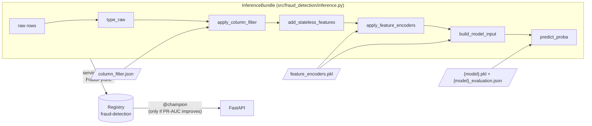

# 7. Serving API

[← 6. Modeling approach](06_modeling_approach.md) · [Table of contents](01_introduction.md#table-of-contents)

The scoring service is a FastAPI app in `src/fraud_detection/api/`. At startup it loads one model
from the MLflow registry, pinned to a concrete version, and returns a fraud probability and a
decision for each transaction.

## How a model reaches the API



1. `InferenceBundle` chains the **same node functions** as the batch pipelines. `type_raw` applies
   the data_ingestion typing rules (categorical keys via `to_key`, dtypes, `id-01` → `id_01`) to
   the columns the column filter keeps. Lookup tables are converted to indexed Series once, which
   gives identical results and avoids re-hashing 100k-key dicts on every request.
2. The `serving` pipeline (`make register`, also part of `make train`) wraps the bundle as an MLflow
   pyfunc and registers it as `fraud-detection`. It stores in the model metadata:
   - the decision **threshold**: `serving.threshold_metric`, default `at_fpr_threshold` (~1% of
     legitimate transactions flagged on valid);
   - the model type;
   - valid PR-AUC.
3. `@champion` moves to the new version only if its `serving.promotion_metric` beats the current
   champion's. The result is written to `data/08_reporting/serving_registration.json`.
   `serving_<model>` registers another model type.

The registered model is the **train-only** `{model}.model`, so the threshold and metrics stored
with it describe exactly that model.

**Parity** is tested in `tests/test_inference.py`: raw rows sent the way the API sends them
(missing keys, numbers as strings) produce exactly the batch model input. On real data, 3,001 raw
CSV rows reproduce `05_model_input/valid.parquet` exactly (395 columns, identical probabilities).

**Two paths, same scores.** `FraudPyfunc.predict` takes either form of raw rows:

| Input | Path | Used by | 1 row | 1000 rows |
|---|---|---|---|---|
| `pd.DataFrame` | `InferenceBundle.predict_proba`: the batch node functions | pipelines, notebooks | ~150 ms | ~220 ms |
| `list[dict]` | `InferenceBundle.predict_records`: NumPy fast path (`fast_inference.py`) | the API | ~2 ms | ~110 ms |

The pandas path pays a fixed ~0.1–1 ms per pandas call, thousands of calls per request, whatever
the row count. The fast path (`RecordScorer`) does the same steps on NumPy arrays: one float64
cast of all numerical columns (validating every value, as `type_raw` does), one cast per storage
dtype, `to_key` per value, plain dict lookups for the fitted encoders, and only the features the
model reads. LightGBM gets the float matrix directly (categories as the codes LightGBM itself would
use); other model types get a DataFrame with category dtypes. Tests check that both paths give
bit-identical features and scores, for any batch size and for every model type; on 2,000 real raw
rows all 395 features and all scores are identical.

One deliberate difference: the fast path keys every value on its own, so `card1` sent as `1001`,
`1001.0` or `"1001"` is the same category, as in training. The pandas path keys a column by its
dtype in the request, so a column mixing strings and floats keys `315.0` as `"315.0"`.

## Endpoints

| Method | Path | Response | Notes |
|---|---|---|---|
| `GET` | `/health/live` | `{"status": "ok"}` | Process is up. Docker `HEALTHCHECK` |
| `GET` | `/health/ready` | `Health` | 503 until a model is loaded: route traffic on this |
| `GET` | `/health` | `Health` | Back-compat, always 200 |
| `POST` | `/predict` | `Prediction` | One transaction |
| `POST` | `/predict/batch` | `list[Prediction]` | 1–1000 transactions, one model call, request order kept |
| `GET` | `/metrics` | Prometheus | HTTP metrics, `fraud_prediction_probability`, `fraud_predictions_total{model_version,is_fraud}` |
| `GET` | `/docs` | Swagger UI | |

Errors: 503 when no model is loaded; 422 for invalid payloads or input the model rejects
(e.g. `TransactionDT` missing); 500 otherwise. Every response carries `X-Request-ID` (echoed or
generated) and `X-Process-Time-Ms`. Each prediction is logged as one JSON line on the
`fraud_detection.api.predictions` logger, for drift monitoring and joining fraud labels later.

### Request: `Transaction`

```json
{
  "TransactionID": 3663549,
  "features": {
    "TransactionDT": 18403224,
    "TransactionAmt": 31.95,
    "ProductCD": "W",
    "card1": 10409,
    "addr1": 315,
    "P_emaildomain": "gmail.com"
  }
}
```

`features` holds the **raw** transaction and identity columns, named as in the Kaggle files.
Absent columns are treated as null; `TransactionDT` is required. `has_identity` is derived (1 if
any identity column is set) unless sent.

### Response: `Prediction`

```json
{
  "TransactionID": 3663549,
  "fraud_probability": 0.0142,
  "is_fraud": false,
  "threshold": 0.273,
  "model_version": "2",
  "model_uri": "models:/fraud-detection/2"
}
```

## Configuration

| Env variable | Default | Meaning |
|---|---|---|
| `MODEL_URI` | `models:/fraud-detection@champion` | Alias, version (`models:/fraud-detection/3`) or `runs:/<id>/...`; an alias is resolved to a version at startup |
| `FRAUD_THRESHOLD` | unset | Overrides the threshold stored with the model |
| `MLFLOW_TRACKING_URI` | — (compose: `http://mlflow:5000`, local: `sqlite:///mlflow.db`) | Where the registry lives |
| `WEB_CONCURRENCY` | `2` | uvicorn workers (Docker) |
| `OMP_NUM_THREADS` | `1` (Docker) | One thread per worker; scale with workers |
| `LOG_LEVEL` | `INFO` | `WARNING` silences per-request / per-prediction logs |

## Running it

```bash
make register                                                     # register + maybe promote
MLFLOW_TRACKING_URI=sqlite:///mlflow.db make api                  # http://localhost:8000/docs
make docker-up                                                    # Postgres + MLflow + API
make loadtest URL=http://localhost:8000                           # full grid below, ~12 min
make loadtest REQUESTS=1000 BATCHES=1                             # one scenario
```

## Load test

`scripts/loadtest.py` is an **open-loop** async test: a scenario sends R requests of B
transactions each, evenly over one minute. Request i leaves at i × 60 / R seconds whether or not
the earlier ones answered, so latency includes queueing when the API falls behind (a closed loop,
which waits for each answer, would hide that). B = 1 goes to `/predict`, B > 1 to `/predict/batch`.

- Grid: R ∈ {1, 10, 1000, 10000} requests per minute × B ∈ {1, 10, 100, 1000} transactions.
- Payloads: real raw rows from `data/01_raw` (transaction + identity, nulls left out), the shape
  a client sends; synthetic rows if the files are missing.
- More than `--max-in-flight` (256) unanswered requests: new ones are dropped and counted, so an
  overloaded API cannot exhaust the client.
- Report: `data/08_reporting/loadtest.{csv,md}`: sent / ok / errors / dropped, achieved req/s
  and rows/s, client p50/p95/p99/max, server time (`X-Process-Time-Ms`), ms per row. Budget
  p99 < 50 ms is checked for B = 1; the exit code is 1 if a single-transaction scenario fails it.

`tests/api/test_loadtest.py` runs the same code in-process (ASGI transport, fake model) on a
scaled-down grid, checks that every generated body validates against `Transaction` /
`TransactionBatch`, and that overload drops requests instead of queueing them.

## Latency

Single-row latency is dominated by pandas per-column overhead: ~400 columns pass through several
pandas operations, and LightGBM converts the 395-column frame (~23 ms), while evaluating the 531
trees takes ~0.3 ms. Measured locally, one worker: p50 ≈ 225 ms per transaction (on a busy
machine). This is above the 50 ms target; see the open options in the README / issue tracker:
fewer features, a row-oriented fast path verified by the parity test, or passing numpy to
LightGBM. Use `/predict/batch` for bulk scoring: 1000 rows take about as long as a few single
requests.

---
[← 6. Modeling approach](06_modeling_approach.md) · [Next: 8. Model card →](08_model_card.md)
